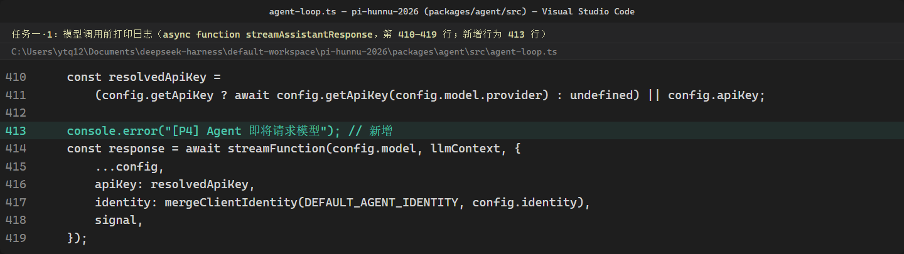
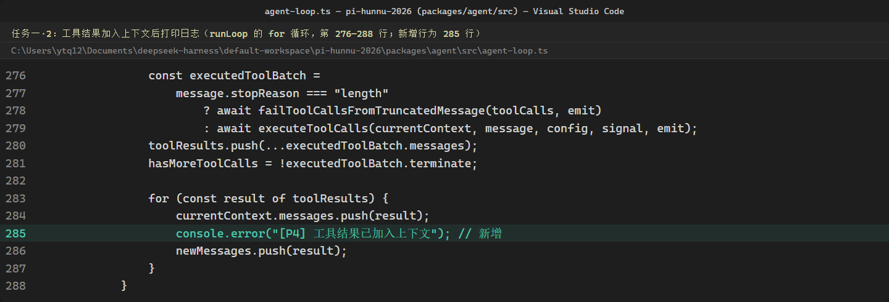
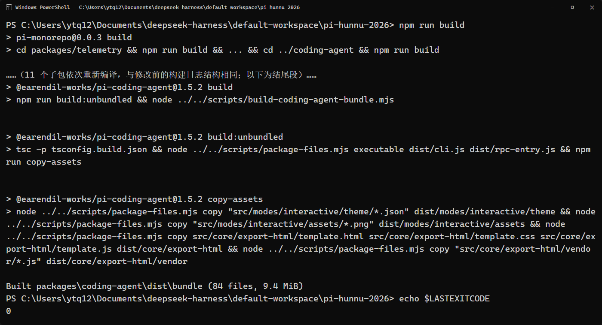
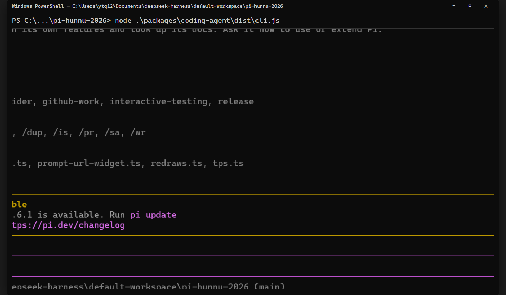
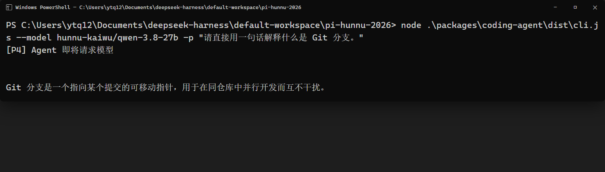
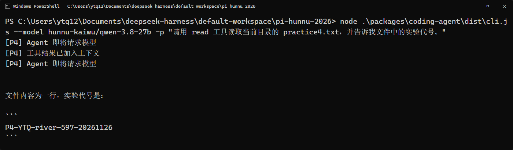
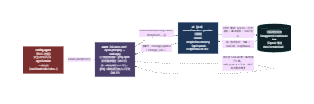

# 实践课4：Pi Agent 的模型调用与运行流程

| 项目 | 内容 |
| --- | --- |
| 姓名 | 杨唐清 |
| 学号 | 202430224092 |
| GitHub 登录名 | sakoto505 |
| 日期 | 2026-11-26 |
| 小组组织仓库 | https://github.com/nai-lon-g/pi-hunnu-2026 |
| 源码版本 | `main` @ `c3cc91632d0a1950fb122605b190233f2aa0006e`（coding-agent v1.5.2） |
| 本次使用的模型 | `hunnu-kaiwu/qwen-3.8-27b`（学校模型平台，A/B 两次会话同一模型） |

> 按作业要求在实践课 3 构建的 Pi 源码上加两行 `[P4]` 日志、重新编译、用编译产物启动，并对比"直接问答"（会话 A）和"读取文件"（会话 B）两次运行，观察 Pi 什么时候请求模型、工具结果如何进入下一轮对话。全部命令在仓库根目录 `C:\Users\ytq12\Documents\deepseek-harness\default-workspace\pi-hunnu-2026` 执行。
>
> 模型说明：本机 `~/.pi/agent` 默认的 deepseek 凭据余额不足（API 返回 402，见实践课 3 报告 6.4 节），故本次显式用 `--model hunnu-kaiwu/qwen-3.8-27b` 走学校模型平台（该 provider 已在实践课 3 的 `~/.pi/agent/models.json` 配好）。A、B 两次会话使用同一模型，满足作业要求。

## 1. 任务一：给 Agent 循环加两行日志

修改文件：`packages/agent/src/agent-loop.ts`（小组版本与教师演示版本行号一致，无需搜索）。`git diff` 如下（图源 `practice4-diagrams/agent-loop.diff`）：

```diff
diff --git a/packages/agent/src/agent-loop.ts b/packages/agent/src/agent-loop.ts
@@ -282,6 +282,7 @@ async function runLoop(

 				for (const result of toolResults) {
 					currentContext.messages.push(result);
+					console.error("[P4] 工具结果已加入上下文"); // 新增
 					newMessages.push(result);
 				}
 			}
@@ -409,6 +410,7 @@ async function streamAssistantResponse(
 	const resolvedApiKey =
 		(config.getApiKey ? await config.getApiKey(config.model.provider) : undefined) || config.apiKey;

+	console.error("[P4] Agent 即将请求模型"); // 新增
 	const response = await streamFunction(config.model, llmContext, {
 		...config,
 		apiKey: resolvedApiKey,
```

**插入位置说明**

1. **第 413 行（修改后行号）**：`async function streamAssistantResponse(...)` 内，`const response = await streamFunction(config.model, llmContext, {...})` 的**上方**——每次 Agent 准备把当前上下文交给模型调用函数时打印一条 `[P4] Agent 即将请求模型`。
2. **第 285 行（修改后行号）**：`runLoop(...)` 内工具结果回写上下文的 `for (const result of toolResults)` 循环里，`currentContext.messages.push(result);` 的**下方**——每写入一条工具结果打印一条 `[P4] 工具结果已加入上下文`。



*图 1（S1）编辑器中的 agent-loop.ts：413 行新增 `[P4] Agent 即将请求模型`，其下方 414 行即 `await streamFunction(config.model, llmContext, {...})`。*



*图 2（S2）编辑器中的 agent-loop.ts：283–287 行 for 循环，284 行 `currentContext.messages.push(result)`，紧接着 285 行新增 `[P4] 工具结果已加入上下文`。*

用 `console.error` 而不是 `console.log`：日志走 stderr，即使 Pi 用 TUI 接管了 stdout（差分渲染），终端里也能看到这两行（作业提示"可能和 Pi 的交互界面混在一起"）。

## 2. 任务二：重新编译并启动



*图 3（S3）项目根目录 `npm run build`：11 个子包依次重新构建（agent 包含新日志行、coding-agent 重新打包），结尾 `Built packages\coding-agent\dist\bundle (84 files, 9.4 MiB)`，`$LASTEXITCODE` 为 0。*

构建结束后直接启动**编译产物**（不是 `pi-test.bat` 源码入口，也不是全局 pi）：

```powershell
node .\packages\coding-agent\dist\cli.js
```



*图 4（S4）真实终端窗口执行 `node .\packages\coding-agent\dist\cli.js`，Pi 交互界面成功打开：底部输入行显示工作目录 `...\pi-hunnu-2026 (main)`，界面加载了仓库 `.pi/skills` 的技能与命令，并提示有 1.6.1 可用（本地源码版本为 1.5.2，比课程 fork 快照更新——fork 之后上游又发过版，不影响本次实验）。*

## 3. 任务三：对比两次运行

先按作业要求在项目根目录创建 `practice4.txt`，写入一行自定实验代号：

```text
P4-YTQ-river-597-20261126
```

两次会话都用同一模型（`hunnu-kaiwu/qwen-3.8-27b`）、各开一个新会话。说明：会话内容用编译产物的**非交互 print 模式**（`-p`，同一次运行"处理提示词并退出"）执行——`[P4]` 日志经 stderr 完整落在终端输出里，顺序与交互模式一致；交互界面本身见图 4（S4）。

### 会话 A：直接问答

输入指令：`请直接用一句话解释什么是 Git 分支。`



*图 5（S5）会话 A 的输入指令、实际出现的 [P4] 日志（仅 1 条）和 Pi 最终回复。*

- **是否调用工具：** 否（没有出现 `[P4] 工具结果已加入上下文`）。
- **模型调用轮数：** 1 轮（"即将请求模型"出现 1 次；模型直接给出答案，循环结束）。
- **最终回复：** "Git 分支是一个指向提交（commit）的可移动指针，允许你在不影响主线代码的情况下并行开发、试验和合并不同版本的功能。"

### 会话 B：读取文件

输入指令：`请用 read 工具读取当前目录的 practice4.txt，并告诉我文件中的实验代号。`（只给文件名，代号留在文件里）



*图 6（S6）会话 B 的输入指令、[P4] 日志（3 条，顺序为 模型→工具结果→模型）和 Pi 返回的实验代号。*

- **Pi 是否读到了自己的代号：** 是——回复为"文件 `practice4.txt` 中只有一个字符串，即实验代号：**P4-YTQ-river-597-20261126**"。
- **模型调用轮数：** 2 轮。
- **[P4] 日志实际顺序**（与作业给出的典型顺序一致）：

```text
[P4] Agent 即将请求模型
[P4] 工具结果已加入上下文
[P4] Agent 即将请求模型
```

### 对比与运行流程

| | 会话 A（直接问答） | 会话 B（读取文件） |
| --- | --- | --- |
| 输入指令 | 请直接用一句话解释什么是 Git 分支。 | 请用 read 工具读取当前目录的 practice4.txt，并告诉我文件中的实验代号。 |
| 是否调用工具 | 否 | 是（read，读取 practice4.txt，1 次） |
| [P4] 日志顺序 | 即将请求模型 ×1 | 即将请求模型 → 工具结果已加入上下文 → 即将请求模型 |
| 模型调用轮数 | 1 | 2 |
| 最终回复 | 一句话解释 Git 分支 | 给出文件里的实验代号 P4-YTQ-river-597-20261126 |

**谁实际读了文件？** 是 **Pi 的 agent 进程本地的 `read` 工具**（`packages/coding-agent/src/core/tools/read.ts`，在本机文件系统上执行 `fs` 读取），**不是远程模型**——模型看不到磁盘。模型只做了两件事：第一轮"决定"调用 read 工具（返回 toolCall），第二轮"看到"工具结果后组织语言回答。`[P4] 工具结果已加入上下文` 这条日志打在 `agent-loop.ts:285`（工具结果 `push` 进上下文之后），证明是 agent 循环把工具输出写进了上下文，模型服务从头到尾只收到过 JSON 消息。

**下一轮模型请求多带了什么？** 第二轮请求的消息数组比第一轮多了一段"工具调用→工具结果"记录：
1. 第一轮 assistant 消息里的 `toolCall`（`read`，参数 `{path: "practice4.txt"}`）；
2. 对应的 `toolResult` 消息——内容就是文件文本 `P4-YTQ-river-597-20261126`。

也就是说，"多带的"不是文件路径或工具名，而是**工具执行结果的完整内容**；模型凭这条结果在第二轮里复述出了代号。这也对应循环的代码：`streamAssistantResponse` 返回带 toolCall 的 assistant 消息 → `executeToolCalls` 本地执行 → 结果 `push` 进 `currentContext.messages`（284 行）→ 循环继续，再走一次 `streamAssistantResponse`（413 行又打一条"即将请求模型"）。

**简图**（coding-agent / agent / ai / 远程模型服务四者关系，可编辑图源 `practice4-diagrams/flow-simple.mmd`）：



*图 7 模块简图：coding-agent 把输入交给 agent 包，agent 循环每轮通过 ai 包的 provider 适配器向远程模型服务发 HTTP 请求、收 SSE 流；响应含 toolCall 时 agent 循环在本地执行工具，把结果写回上下文再进入下一轮（虚线自环）。*

## 4. 截图清单

| 图 | 内容 | 文件 |
| --- | --- | --- |
| S1 | 413 行模型调用前日志（下方可见 streamFunction 调用） | `practice4-images/01-s1-editor-model-log.png` |
| S2 | 285 行 for 循环内工具结果日志 | `practice4-images/02-s2-editor-tool-log.png` |
| S3 | npm run build 结尾 + 退出码 0 | `practice4-images/03-s3-build-exit0.png` |
| S4 | 启动 dist\cli.js + Pi 交互界面 | `practice4-images/03-s4-launch-tui.png` |
| S5 | 会话 A（指令/日志/回复） | `practice4-images/04-s5-sessionA.png` |
| S6 | 会话 B（指令/日志/代号） | `practice4-images/05-s6-sessionB.png` |
| 图 7 | 模块简图 | `practice4-images/06-flow-simple.png` |

- 代码差异源文件：`practice4-diagrams/agent-loop.diff`
- 简图源：`practice4-diagrams/flow-simple.mmd`
- 截图中不含 API Key、auth.json 或授权回调地址（会话日志只含 [P4] 行与模型回复）。

## 5. 提交

- 本报告与图片：https://github.com/sakoto505/pi-agent-homework/blob/main/practice-04.md
- 小组代码仓库：https://github.com/nai-lon-g/pi-hunnu-2026
