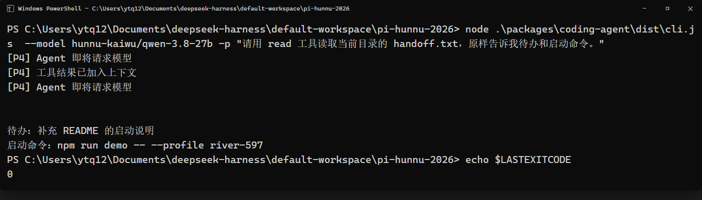
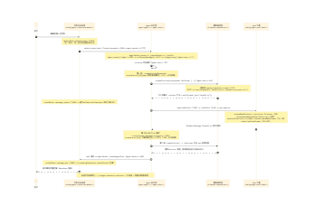
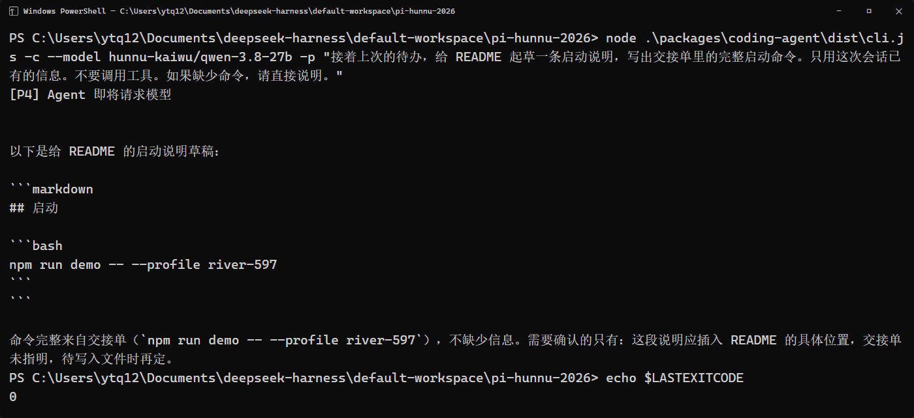
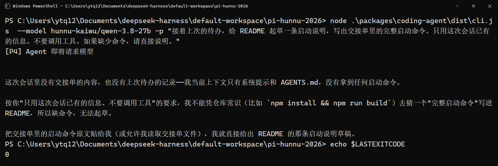
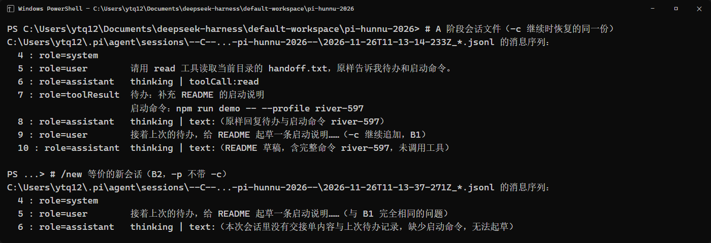
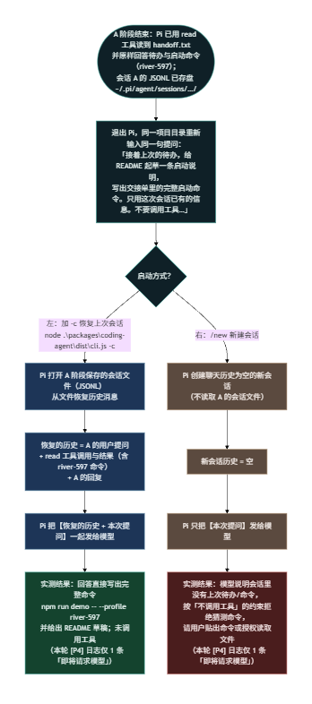

# 实践 05：Pi Agent 源码泛读与功能定位

| 项目 | 内容 |
| --- | --- |
| 姓名 | 杨唐清 |
| 学号 | 202430224092 |
| GitHub 登录名 | sakoto505 |
| 日期 | 2026-11-26 |
| 小组组织仓库 | https://github.com/nai-lon-g/pi-hunnu-2026 |
| 源码版本 | `main` @ `c3cc91632d0a1950fb122605b190233f2aa0006e`（含实践 04 加的两行 `[P4]` 日志并重新构建） |
| 模型 | `hunnu-kaiwu/qwen-3.8-27b`（学校模型平台，全程同一模型） |

> 从真实操作回到源码：A 阶段用 read 工具读一次 `handoff.txt`，画出**代码级时序图（图 1）**；B 阶段退出 Pi 后分别用 `-c`（恢复旧会话）和新会话（`/new` 等价）问同一个问题，对照两种情况下**哪些消息被发给模型**，画出**对照图（图 2）**。图 1/图 2 的箭头全部标注了按源码核对过的真实函数名与行号。

## A. 单轮交互与工具调用（复用实践 04 的构建与日志）

### A.1 实验设置与运行记录

在工作目录（仓库根）创建 `handoff.txt`，两行（`river-597` 为本组随机生成的标识，替代示例中的 river-731；提问里不透露命令）：

```text
待办：补充 README 的启动说明
启动命令：npm run demo -- --profile river-597
```

启动本地构建的 Pi（实践 04 的 `node .\packages\coding-agent\dist\cli.js` 产物），新会话输入：

> 请用 read 工具读取当前目录的 handoff.txt，原样告诉我待办和启动命令。

实际运行结果（[P4] 日志 + 模型回复）：



*图 A1 会话 A（handoff 读取）：输入指令、3 条 [P4] 日志（模型 → 工具结果 → 模型，read 执行 1 次）、Pi 原样回复的待办与启动命令（`river-597` 来自文件而非提问）。*

**本轮观察记录：** 一次用户输入 = 一次 `runLoop`，其中发生了 **2 次模型调用 + 1 次 read 工具执行**，与作业给出的典型日志顺序一致（`[P4]` 行序：即将请求模型 → 工具结果已加入上下文 → 即将请求模型）。

### A.2 图 1：单轮工具调用的代码级时序图



*图 1 五条生命线：用户 / 交互与会话层（coding-agent interactive-mode.ts）/ Agent 执行层（agent agent.ts + agent-loop.ts）/ 模型请求层（ai openai-completions.ts）/ read 工具（coding-agent tools/read.ts）。箭头与注释均为按源码核对的真实函数与行号（1.5.2 版本）。可编辑图源：`practice5-diagrams/fig1-sequence.mmd`。*

按调用路径对照源码说明（本次实际走的就是这条路径）：

1. **输入入口**：`interactive-mode.ts:3325` 设置 `this.defaultEditor.onSubmit`（编辑器回车回调，即 `onSubmit`）；非 `/`、非 `!` 开头的普通文本在 `interactive-mode.ts:3494` 调 `await this.session.prompt(text)`。
2. **会话层**：`AgentSession.prompt()`（`agent-session.ts:2175`）→ `_preparePrompt`（:2175 起，扩展命令/输入钩子/模板展开/鉴权预检）→ `_startRun`（:2208 调用）进入 agent 运行。
3. **启动循环**：`Agent.prompt()`（`agent.ts:382`）→ `normalizePromptInput`（:388）→ `runPromptMessages`（:389/:441）→ `runAgentLoop`（`agent-loop.ts:111`）→ `runLoop`（:172）。
4. **模型请求**：`runLoop` 每轮调 `streamAssistantResponse`（`agent-loop.ts:391`）：`config.convertToLlm(messages)`（:404，AgentMessage[]→Message[]）→ `normalizeContext`（:406）→ 解析 API key（:409-410）→ **`[P4]` 日志（:413，实践 04 新增）** → `streamFunction(config.model, llmContext, {...})`（:414）。`streamFunction` 默认取自 `getDefaultStreamFn()`（`agent/src/stream-fn.ts:15`，由宿主在启动时经 `setDefaultStreamFn` 注入 ai 包的流函数）。
5. **模型与文件边界**：模型请求层里，适配器 `packages/ai/src/api/openai-completions.ts:312` 的 `stream` 函数把请求 POST 到远端（本次为 `https://models.hunnu.edu.cn/v1/chat/completions`，OpenAI 兼容协议），SSE 流式收响应。**文件系统调用不在模型侧**，标在 read 工具生命线下方：`read.ts:267` `resolveReadPathAsync` → `read.ts:270` `ops.access`（`fs.promises.access` 判可读）→ 文本分支 `read.ts:300-308`：
   - 实际走的是**流式读取**：本次 read 没传 offset/limit，`isStreamableRange(undefined, undefined)`（`read.ts:122-127`）为 true，于是走 `selectLinesFromStream(ops.createReadStream(...))`（:301-307）；`createReadStream` 绑定到 `readLocalFileChunks`（`read.ts:70/:81-92`）——`fs.promises.open(path, "r")` + `handle.createReadStream({ end: size-1, autoClose: false })` 按块 yield，只把要显示的行留在内存；
   - 缓冲区读取 `selectLinesFromBuffer(await ops.readFile(...))`（:308，`fs.promises.readFile` 整文件）只在操作对象没提供 `createReadStream`、或范围不是可流式（如 `limit: -1`）时走。
6. **工具执行回环**：模型返回带 `toolCall` 的 assistant 消息后，`runLoop` 调 `executeToolCalls`（`agent-loop.ts:520`，:279 处调用）→ `runToolCall`（:816）→ read 工具 `execute` 返回 `ToolResultMessage` → 回到 :283-286 的 for 循环：`currentContext.messages.push(result)`（:284）→ **`[P4]` 日志（:285，实践 04 新增）**→ `newMessages.push(result)`（:286）→ 循环再次进入 `streamAssistantResponse`（第二轮请求模型时，llmContext 里已含这条 toolResult）。
7. **显示回复**：事件经 `AgentSession` 内部 `this.agent.subscribe(this._handleAgentEvent)`（`agent-session.ts:548`）转发到 UI 侧的 `AgentSession.subscribe`（:1455）→ `interactive-mode.ts:3526` `this.session.subscribe(async (event) => this.handleEvent(event))` → `handleEvent`（:3531）：
   - `case "message_update"`（:3649）：助手流式更新时刷新 markdown 组件；消息里出现 `toolCall` 内容块时创建 `ToolExecutionComponent`（:3657）显示"read 工具执行中"卡片——**这就是终端里看到 read 在干活的位置**；
   - `case "message_end"`（:3685）：助手消息结束，`streamingComponent.updateContent(..., false)`（:3698）定稿——**用户最终看到回复的位置**。
8. **会话落盘**：`AgentSession` 把每条消息追加写入 `~/.pi/agent/sessions/<cwd 哈希>/` 下的 JSONL 会话文件（B 阶段 `-c` 恢复的数据来源）。

## B. 恢复上次会话，继续写 README

A 阶段结束后 Pi 已读到并回答了启动命令。退出 Pi，在同一项目目录、同一模型下做两个对照。

> 运行方式说明：`-p` print 模式每次运行即一个"新会话"，与交互界面里输入 `/new` 的初始状态等价；`-c` 为 `--continue` 简写。B1 命令即作业要求的 `node .\packages\coding-agent\dist\cli.js -c`（附加 `--model` 与 `-p` 参数，模型与 A 相同）。

### B.1 恢复原会话（-c）

```powershell
node .\packages\coding-agent\dist\cli.js -c --model hunnu-kaiwu/qwen-3.8-27b -p "接着上次的待办，给 README 起草一条启动说明，写出交接单里的完整启动命令。只用这次会话已有的信息。不要调用工具。如果缺少命令，请直接说明。"
```



*图 B1 `-c` 运行：本轮 [P4] 日志只有 1 条"即将请求模型"（没有"工具结果已加入上下文"，即**没有重新读文件**），但回复完整写出交接单里的启动命令 `npm run demo -- --profile river-597` 并给出 README 草稿——证据支持答案来自恢复的会话历史。*

### B.2 新建会话（/new 等价）

同一目录、同一模型、完全相同的问题（不带 `-c`，新会话）：



*图 B2 新会话运行：同样只有 1 条 [P4] 日志；模型回答"这次会话里没有交接单的内容，也没有上次待办的记录……没有拿到任何启动命令"，按"不要调用工具"的约束拒绝猜测命令，请用户贴出命令或授权读取文件。*

**两次对照：**

| | B1（-c 恢复旧会话） | B2（/new 等价新会话） |
| --- | --- | --- |
| 本轮调用工具 | 否（[P4] 无"工具结果"行） | 否（问题本身禁止调用工具） |
| 答案 | 完整写出 `npm run demo -- --profile river-597` + README 草稿 | 明说会话里没有命令，缺命令无法起草 |
| 结论 | 历史来自 A 阶段恢复的会话文件 | 新会话历史为空 |

### B.3 会话文件层面的直接证据

`~/.pi/agent/sessions/--C--...-pi-hunnu-2026--/` 下，A 阶段与 B1 落在**同一个 JSONL 文件**（`-c` 把新问答追加进 A 的会话），B2 是**另一个只有 3 条消息的新文件**：



*图 B3 会话文件消息序列：`…11-13-14….jsonl` = A 的 system→user(read handoff)→assistant(toolCall:read)→toolResult(river-597)→assistant(回复)，再追加 B1 的 user→assistant；`…11-13-37….jsonl` = 仅 system→user(同样的问题)→assistant(说明缺命令)。*

### B.4 图 2：恢复旧会话和新建会话的对照图



*图 2 两条分支：左（`-c`）恢复 A 的会话文件 → 模型请求 = 恢复的历史（含 read 的 toolResult，river-597）+ 本次提问 → 能写出完整命令且未再读文件；右（`/new`）新会话历史为空 → 模型请求只有本次提问 → 只能报告缺命令。可编辑图源：`practice5-diagrams/fig2-resume-vs-new.mmd`。*

**结合 B 的日志回答作业问题：**

- **谁实际读了文件？** 是 Pi 进程在本机执行的 read 工具（`read.ts`，`fs.promises.open` + `createReadStream` 流式读取），不是模型；B1 的 `[P4]` 日志只有 1 条"即将请求模型"、0 条"工具结果已加入上下文"，证明这一轮**没有再读文件**——river-597 是 A 阶段那次 toolResult 躺在恢复的历史里，被原样带给了模型。
- **下一轮（B1）模型请求多带了什么？** 比 B2 多了 A 阶段恢复出的 4 条历史消息：A 的 user 提问、assistant 的 `toolCall(read, {path:"handoff.txt"})`、**toolResult（含两行交接内容）**、A 的 assistant 回复。B2 的请求里这四条全部不存在——这就是两个回答差异的唯一来源。

## 图与图源清单

| 文件 | 内容 |
| --- | --- |
| `practice5-images/01-fig1-sequence.png` | 图 1 单轮工具调用代码级时序图 |
| `practice5-diagrams/fig1-sequence.mmd` | 图 1 Mermaid 可编辑图源 |
| `practice5-images/02-fig2-resume-vs-new.png` | 图 2 恢复 vs 新建对照图 |
| `practice5-diagrams/fig2-resume-vs-new.mmd` | 图 2 Mermaid 可编辑图源 |
| `practice5-images/03-sessionA-handoff.png` | A 阶段运行记录（指令/[P4]/原样回复） |
| `practice5-images/04-sessionB1-continue.png` | B1（-c）运行记录 |
| `practice5-images/05-sessionB2-new.png` | B2（新会话）运行记录 |
| `practice5-images/06-session-files.png` | 会话 JSONL 消息序列对照 |

截图中不含 API Key、auth.json 或授权回调地址。

## 提交

- 本报告与图片：https://github.com/sakoto505/pi-agent-homework/blob/main/practive-05.md
- 小组代码仓库：https://github.com/nai-lon-g/pi-hunnu-2026
