# 实践课 1：Pi Agent 安装与基础使用

| 项目 | 内容 |
| --- | --- |
| 姓名 | 杨唐清 |
| 学号 | 202430224092 |
| 班级 | 软件工程二班 |
| 完成日期 | 2026-11-10 |
| 练习目录 | `E:\pi-work` |

> 本报告记录 Pi 客户端（v1.5.0）在 Windows 11 + PowerShell 环境下的安装、模型配置、会话、模型/思考级别切换、`@` 文件引用、图片输入、插件安装与调用的完整过程。文中截图均来自本机实际操作，未包含任何 API Key、授权链接或 `auth.json` 内容。

## 一、实验环境

| 项目 | 说明 |
| --- | --- |
| 操作系统 | Windows 11 |
| 终端 | Windows PowerShell / Windows Terminal |
| Pi 客户端 | v1.5.0（官方安装脚本 `https://pi.dev/install.ps1`） |
| 模型提供商 | DeepSeek（API Key 方式） |
| 使用模型 | `deepseek-v4-pro`（默认）、`deepseek-flash`（切换验证） |
| 工作目录 | `E:\pi-work`（专门用于本实践的练习目录） |
| 辅助工具 | `fd`、`rg`（Pi 启动时自动下载，见第八节） |

## 二、任务一：本地安装并启动 Pi

### 2.1 实现过程

1. 打开 Pi 官方仓库/文档，确认安装命令来源为 `https://pi.dev/install.ps1`。
2. 在 PowerShell 中执行官方安装脚本：

   ```powershell
   powershell -c "irm https://pi.dev/install.ps1 | iex"
   ```

3. 按安装器提示完成安装。安装完成后关闭旧终端并重新打开，创建专用练习目录并启动：

   ```powershell
   mkdir pi-work
   cd pi-work
   pi
   ```

### 2.2 运行输出

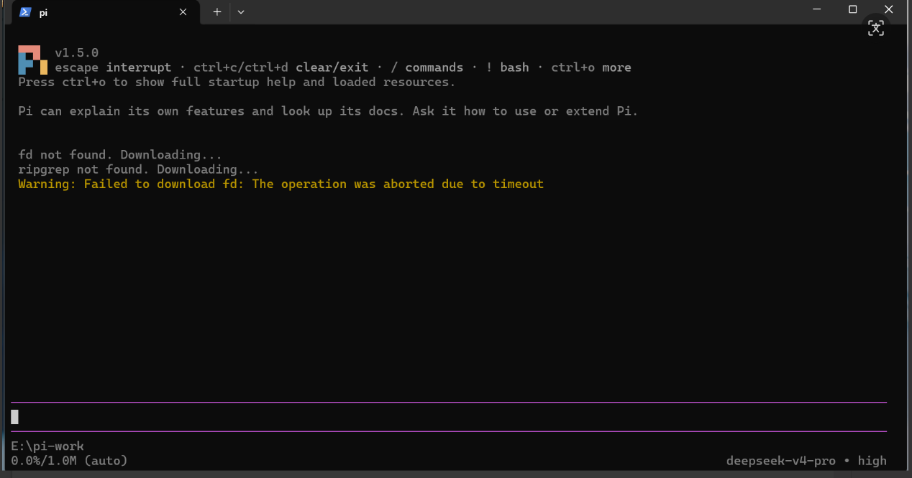

*图 1　Pi 启动成功（版本 v1.5.0，工作目录 `E:\pi-work`，底部状态栏显示 `deepseek-v4-pro • high`）*

### 2.3 结果说明

- 界面顶部显示 `pi v1.5.0`，说明客户端安装成功并可正常启动，而不是仅下载了安装包。
- 底部状态栏显示当前工作目录 `E:\pi-work`、模型 `deepseek-v4-pro` 与思考级别 `high`。
- 首次启动时 Pi 提示 `fd`、`rg` 未找到并尝试下载，因网络超时出现黄色警告；该问题在后续启动中自动解决（见第八节）。
- 界面提示 `Press ctrl+o to show full startup help and loaded resources`，后续任务五、任务六的资源列表即通过该入口查看。

## 三、任务二：配置模型并完成一次会话

### 3.1 实现过程

1. 在 DeepSeek 官方 API 平台创建个人 API Key（密钥不回显、不写入报告）。
2. 回到 Pi 输入 `/login`，选择 `Sign in with an API key`，搜索并选择 DeepSeek 提供商，粘贴密钥完成配置。
3. 配置完成后发送第一条消息 `hello`，验证模型可以正常回复。

### 3.2 运行输出

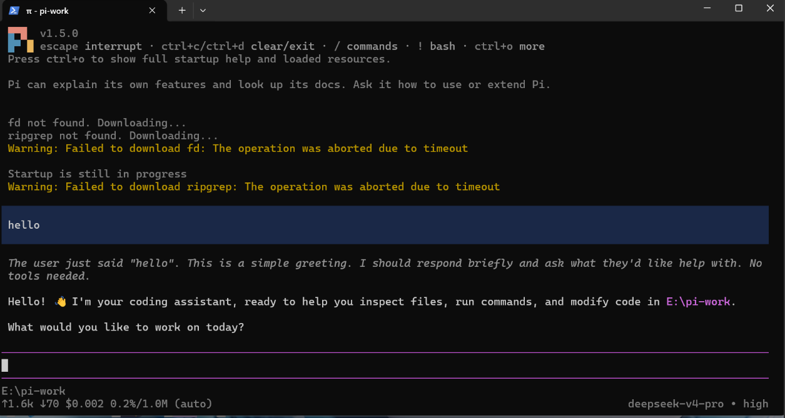

*图 2　`hello` 会话：模型回复正常，底部状态栏显示 `deepseek-v4-pro • high` 与本次请求的 token/费用统计*

### 3.3 结果说明

- 截图同时包含自己发出的提示词 `hello`、模型实际回复和当前模型信息（状态栏），满足任务二的验收要求。
- 回复内容为英文问候并询问下一步任务，说明 API Key 配置成功、模型可正常调用。
- 报告中不出现密钥、`auth.json` 或授权回调链接。

## 四、任务三：切换模型与思考级别

### 4.1 切换模型

1. 输入 `/model` 打开模型选择器，记录切换前模型为 `deepseek-v4-pro`（default）。
2. 选择列表中的 `deepseek-flash`（DeepSeek V4.1 Flash）并回车确认。
3. 切换后发送短问题“请用一句话解释持续集成”，确认会话仍正常。

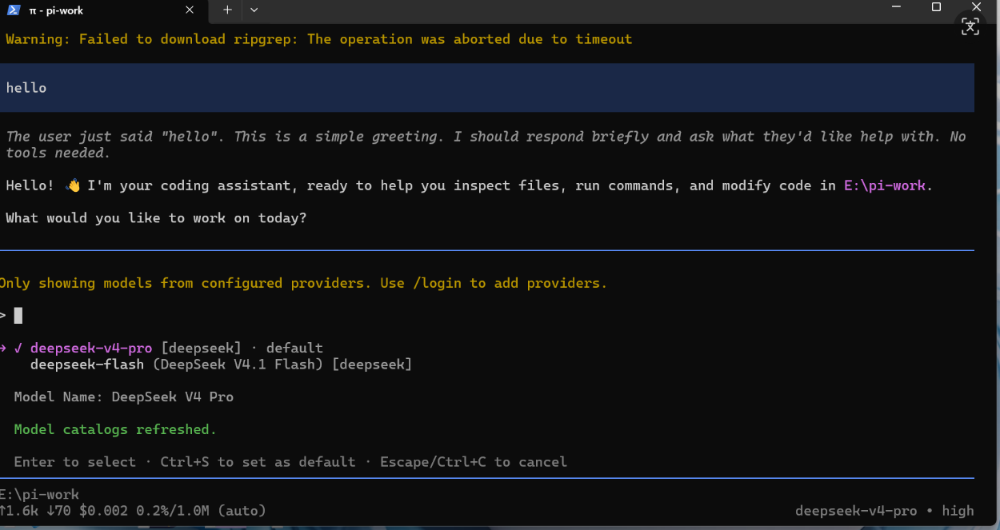

*图 3　`/model` 模型选择器（切换前）：`deepseek-v4-pro [deepseek] · default`，另一可选模型为 `deepseek-flash`*

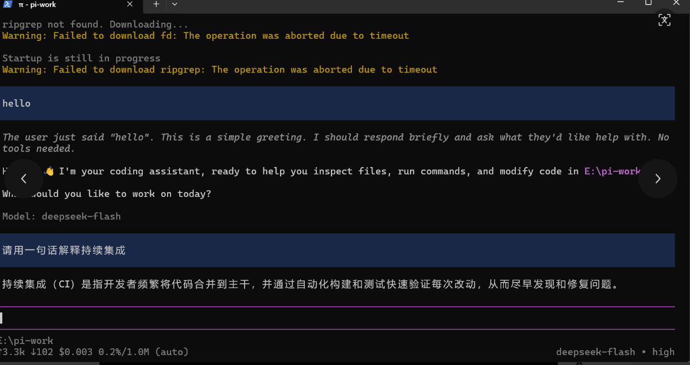

*图 4　切换后：`Model: deepseek-flash`，对“请用一句话解释持续集成”给出正常回答，底部状态同步为 `deepseek-flash`*

### 4.2 切换思考级别

打开 `/thinking`（或按 `Shift+Tab` 循环）查看思考级别菜单：

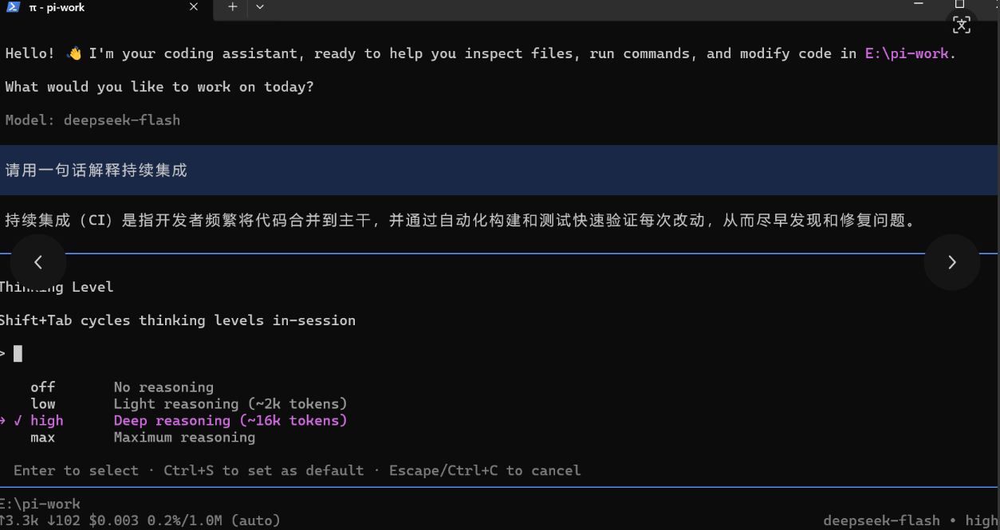

*图 5　`/thinking` 思考级别菜单，当前为 `high`（Deep reasoning，约 16k tokens）*

### 4.3 切换前后状态记录

| 项目 | 切换前 | 切换后 |
| --- | --- | --- |
| 模型 | `deepseek-v4-pro`（DeepSeek V4 Pro） | `deepseek-flash`（DeepSeek V4.1 Flash） |
| 思考级别 | `high` | `high` |
| 会话验证 | `hello` 正常回复 | “请用一句话解释持续集成”正常回复 |

说明：

- 模型切换后状态栏由 `deepseek-v4-pro • high` 变为 `deepseek-flash • high`，证明切换真实生效，而不是仅打开了选择器。
- 思考级别菜单提供 `off / low / high / max` 四档，分别对应“无推理 / 轻量推理（约 2k tokens）/ 深度推理（约 16k tokens）/ 最大推理”。本次实验以简单问答为主，最终保持在 `high`；若处理复杂推理任务可上调至 `max`，简单任务可下调至 `off/low` 以减少等待时间和用量。
- 思考级别是模型的推理设置，不是更换模型；较高档位不保证答案更好，但会增加等待与 token 消耗。

## 五、任务四：引用代码文件与粘贴图片

### 5.1 A：使用 @ 引用代码文件

练习目录中的 `hello.py`（根据截图中的解释整理）：

```python
#!/usr/bin/env python3
"""A minimal greeting script."""

def greet(name: str = "World") -> str:
    return f"Hello, {name}!"

if __name__ == "__main__":
    import sys
    name = sys.argv[1] if len(sys.argv) > 1 else "World"
    print(greet(name))
```

在 `E:\pi-work` 启动 Pi，输入 `@` 并从候选列表中选择 `hello.py`，然后发送：

> 请解释 @hello.py 的功能，说明运行后输出什么。只解释，不修改文件。

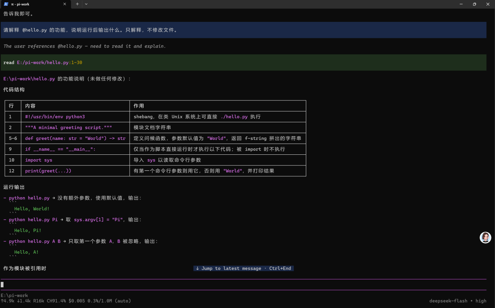

*图 6　`@hello.py` 引用后，Pi 调用 `read E:\pi-work/hello.py:1-30` 读取文件，并逐行解释代码结构、三种运行方式的输出及被 import 时的行为*

结果说明：

- 截图中可以看到引用的文件名 `@hello.py`、问题原文和实际回复，满足 S4 要求。
- 回复解释了 `greet()` 的作用，并给出 `python hello.py` → `Hello, World!`、`python hello.py Pi` → `Hello, Pi!`、`python hello.py A B` → `Hello, A!` 三种运行结果，说明 `@` 引用确实把文件内容提供给了模型。
- 模型明确说明“未做任何修改”，符合提示词“只解释，不修改文件”的约束。

### 5.2 B：粘贴小图片测试

1. 准备一张白底、蓝色手绘数字 7 的测试图片，将图片内容复制到剪贴板。
2. 切换到支持图片输入的模型（`deepseek-flash`），在输入区按 `Alt+V` 粘贴图片（Pi 帮助中标注 `alt+v to paste files on macOS, images, or text`）。
3. 确认输入区出现图片附件后发送：

> 请描述图片中的颜色、形状和数字。


*图 7　粘贴到 Pi 的测试小图片*

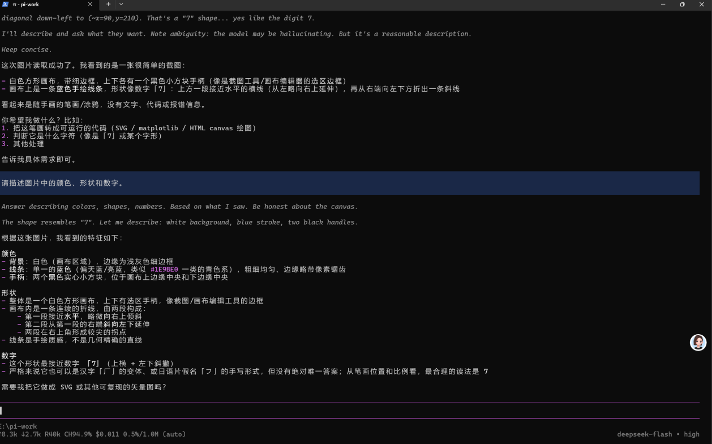

*图 8　图片输入测试：Pi 识别出白色画布、蓝色手绘线条、形似数字“7”，并指出画布上下边缘的两个黑色小方块手柄*

结果说明：

- 回复准确描述了图片的背景颜色（白色）、线条颜色（蓝色）、形状（手绘的 7）以及画布边框上的两个黑色方块手柄，说明图片粘贴与模型视觉输入均正常。
- 提示词“请描述图片中的颜色、形状和数字”与回复同时出现在截图中，满足 S5 要求。

## 六、任务五：安装并使用一个插件

### 6.1 插件信息

| 项目 | 内容 |
| --- | --- |
| 插件名称 | `pi-web-access` |
| 来源 | Pi Packages（<https://pi.dev/packages>）对应的 npm 包 `npm:pi-web-access` |
| 安装命令 | `pi install npm:pi-web-access -l --approve`（安装到当前项目） |
| 作用 | 为 Pi 提供网页访问能力（`fetch` 工具，可抓取网页内容） |
| 所需配置 | 无额外配置，安装后重启 Pi 即可加载 |

### 6.2 安装过程

在 `E:\pi-work` 目录下执行本地安装命令（`-l` 表示仅当前项目使用）：

```powershell
cd E:\pi-work
pi install npm:pi-web-access -l --approve
```

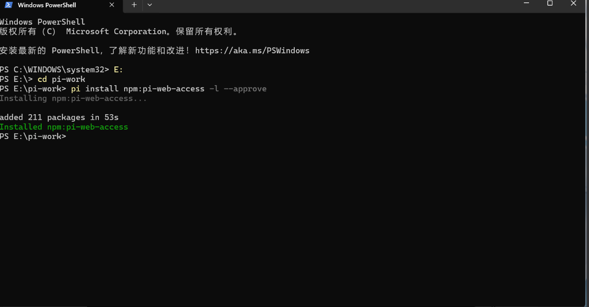

*图 9　`pi install npm:pi-web-access -l --approve` 执行结果：`added 211 packages in 53s`，`Installed npm:pi-web-access`*

### 6.3 重启后的加载信息

退出原 Pi 会话，在终端重新输入 `pi` 启动，启动界面出现 `[Extensions]` 区域并显示 `pi-web-access`：

![图 10 重启后 [Extensions] 区域显示 pi-web-access](images/{896DD725-DB10-4C26-8D01-D6996D466456}.png)

*图 10　重启 Pi 后 `[Extensions]` 区域加载 `pi-web-access:dist`；同时 `fd`、`rg` 已自动安装到 `C:\Users\ytq12\.pi\agent\bin`*

按 `Ctrl+O` 查看完整启动资源，可见插件按 `project`（项目级）来源列出：

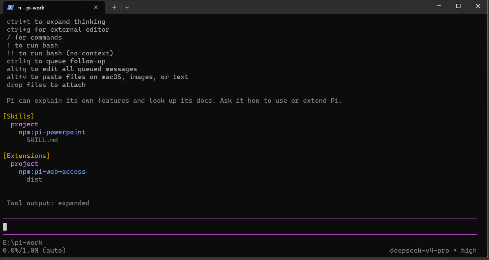

*图 11　启动资源列表：`[Extensions]` 下 `project → npm:pi-web-access → dist`；`[Skills]` 下另有 `project → npm:pi-powerpoint → SKILL.md`*

### 6.4 功能试用

发送提示词：

> 请获取 https://example.com 的页面标题

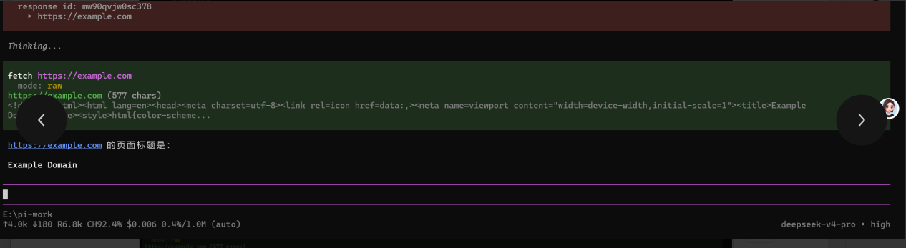

*图 12　插件调用 `fetch https://example.com`（mode: raw，577 chars），返回页面标题 `Example Domain`*

结果说明：

- 安装成功（图 9）、重启后加载成功（图 10、图 11）、功能调用成功（图 12）三个层次均有截图证明。
- `fetch` 工具实际抓取到页面 HTML，并从中提取出标题 `Example Domain`，说明插件功能可用。
- 重启后模型恢复为默认的 `deepseek-v4-pro`，与安装前的切换状态无关，属于正常现象。

## 七、任务六（选做）：让 AI 安装 PPT Skill

本次未完成任务六要求的“从 `anthropics/skills` 下载 `skills/pptx` 到项目 `.pi/skills/pptx` 并用 `/skill:pptx` 调用”，因此该项标记为未完成。

作为补充，在任务五的重启资源列表中可以看到 Pi 也能发现 Skill 形式的扩展（`[Skills]` 下的 `npm:pi-powerpoint`）。向 Pi 询问该 Skill 的信息时，它读取了 `SKILL.md` 并回答了名称、用途和所在目录：

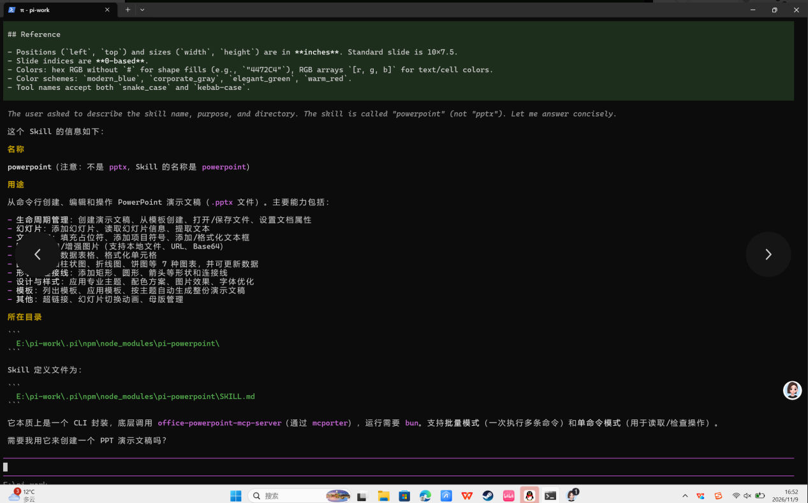

*图 13　Pi 读取 `npm:pi-powerpoint` 的 `SKILL.md` 后说明：名称为 `powerpoint`（不是 `pptx`），用于创建/编辑 PPTX，位于 `E:\pi-work\.pi\npm\node_modules\pi-powerpoint\`*

说明：

- 该 Skill 是 npm 形式安装的技能包，与任务六要求的“从 GitHub 下载到项目 `.pi/skills/pptx`”不是同一路径，因此不作为任务六的完成依据。
- 该现象说明 Pi 的 Skill 发现机制：只要放在约定的技能目录中，启动后就会出现在 `[Skills]` 列表，并可通过对话或 `/skill:名称` 调用。

## 八、遇到的问题与解决

| 问题 | 现象 | 原因分析 | 解决方法 |
| --- | --- | --- | --- |
| `fd`、`rg` 下载超时 | 首次启动出现 `Warning: Failed to download fd/ripgrep: The operation was aborted due to timeout` | 首次启动自动下载辅助工具时网络超时 | 重新启动 Pi 后自动重试，最终安装到 `C:\Users\ytq12\.pi\agent\bin\fd.exe`、`rg.exe`（图 10） |
| 模型列表只有默认模型 | `/model` 中最初只显示 `deepseek-v4-pro` | 模型目录未刷新 | 执行 `/model` 后界面提示 `Model catalogs refreshed.`，出现 `deepseek-flash` 可选（图 3） |
| 图片粘贴无反应 | 直接 `Ctrl+V` 未出现附件 | 终端粘贴快捷键与图片剪贴板不匹配 | 按 Pi 帮助提示使用 `Alt+V` 粘贴图片，确认出现附件后再发送（图 8） |
| 会话内容过长 | 早期内容被滚出屏幕 | 终端显示区域有限 | 使用 `PgUp/PgDn` 或 `Ctrl+End`（Jump to latest message）回看 |

## 九、总结与体会

1. **安装与启动**：Pi 是一个终端形态的 AI 编程助手，安装脚本只安装客户端，模型推理仍由远端提供商完成，本地不部署模型权重。启动后通过状态栏即可确认版本、工作目录、当前模型和思考级别。
2. **模型配置**：`/login` 支持 API Key 与账户登录两种方式；本次使用 DeepSeek API Key，配置成功后即可正常会话。密钥只保存在本机，报告中不出现任何密钥信息。
3. **模型与思考级别**：`/model` 用于切换模型（本次 `deepseek-v4-pro` → `deepseek-flash`），`/thinking` 用于调整推理档位（`off/low/high/max`）。两者相互独立：切换模型改变的是“由谁回答”，调整思考级别改变的是“回答前推理多少”。
4. **上下文引用**：`@文件名` 会把文件内容作为上下文提供给模型，配合 `read` 工具可以精确解释代码；直接粘贴图片则让模型具备视觉输入能力，`Alt+V` 是 Windows 下的粘贴方式。
5. **插件与 Skill**：`pi install npm:包名` 用于安装插件，`-l` 表示仅当前项目生效；安装后必须重启 Pi，看到 `[Extensions]` 中的包名才算加载成功。Skill 与插件不同，前者是任务说明与支持文件，放在 `.pi/skills` 等约定目录后会被自动发现。
6. **不足与改进**：本次未完成任务六（选做）的 PPT Skill 安装与 `/skill:pptx` 调用；后续将按指导书从 `anthropics/skills` 下载 `skills/pptx` 到项目 `.pi/skills/pptx`，核对 `SKILL.md`、`LICENSE.txt` 与 `scripts` 后，用 `/skill:pptx` 完成一次最小调用。

## 十、提交信息

- 仓库地址：`（提交时填写个人仓库地址）`
- Issue 标题：`实践课1：Pi Agent安装与使用 yangtangqing`
- 仓库结构：

```text
.
├── README.md                # 本报告（可将本文件重命名为 README.md）
└── images/                  # 全部截图与测试小图
    ├── {1F66FD21-...}.png
    ├── ...
    └── test-image.png
```

- 截图清单：

| 图号 | 内容 | 文件 |
| --- | --- | --- |
| 图 1 | Pi 启动成功 | `{1F66FD21-BBE8-4A36-9108-866A630986A5}.png` |
| 图 2 | hello 会话 | `{FD62D3B6-92D1-4CE9-BF99-083FB857987F}.png` |
| 图 3 | 模型选择器（切换前） | `{B97379A4-5C61-405C-8CD4-D7F23363294B}.png` |
| 图 4 | 切换为 deepseek-flash 后会话 | `{8E8B4C5D-6AC1-4373-A3E5-405F28FB217C}.png` |
| 图 5 | 思考级别菜单 | `{DFB31411-5D51-4E18-9853-D776FD2997FC}.png` |
| 图 6 | @hello.py 引用与解释 | `{A07908D5-FE0E-4837-82A3-65A78B866CC2}.png` |
| 图 7 | 测试小图片 | `test-image.png` |
| 图 8 | 图片识别结果 | `{9B9E1B2C-C4EB-41E5-8B05-6C510E460C2F}.png` |
| 图 9 | 安装 pi-web-access | `{8306AB22-3FEC-4270-A68E-2A175292D7C9}.png` |
| 图 10 | 重启后 [Extensions] 加载 | `{896DD725-DB10-4C26-8D01-D6996D466456}.png` |
| 图 11 | 启动资源列表 | `{E3CB737C-7BF6-4B92-8E91-C146A6CB30DD}.png` |
| 图 12 | fetch 页面标题 | `{85AE97E5-5F68-4541-9BE6-FB170F67DFFF}.png` |
| 图 13 | powerpoint Skill 说明 | `{8FCB2DD2-F49E-4ECA-8CE1-EC96B48E7FDB}.png` |
