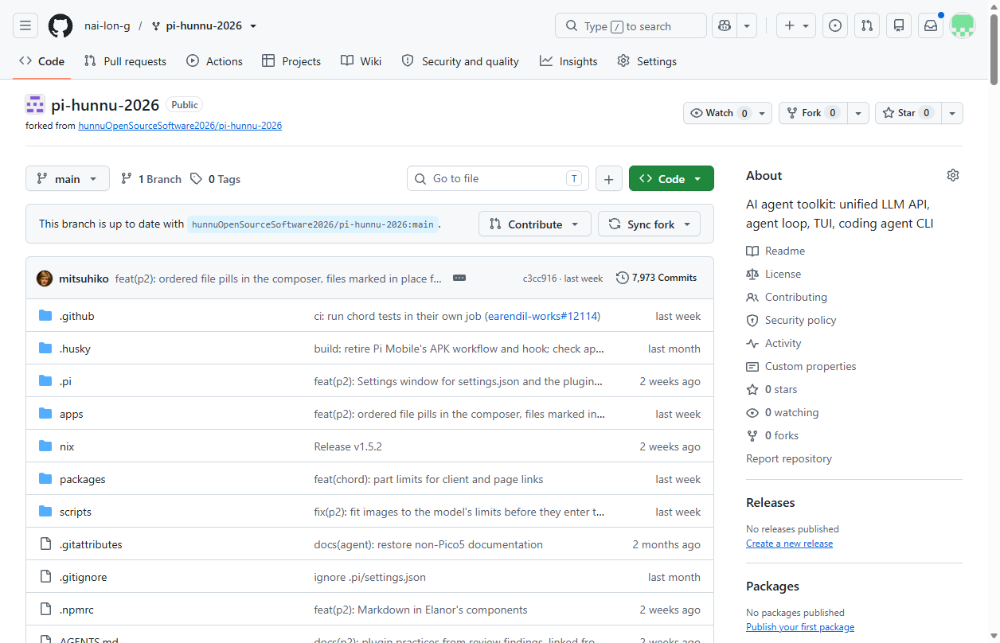
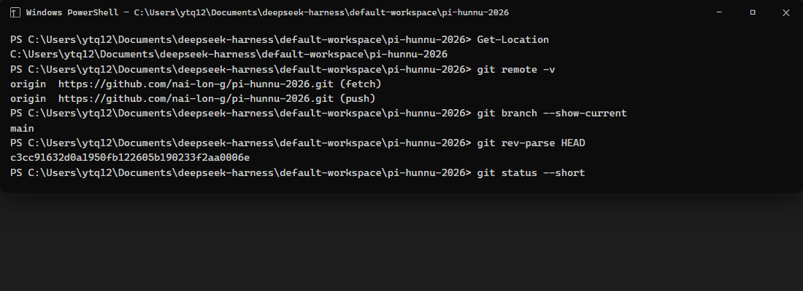
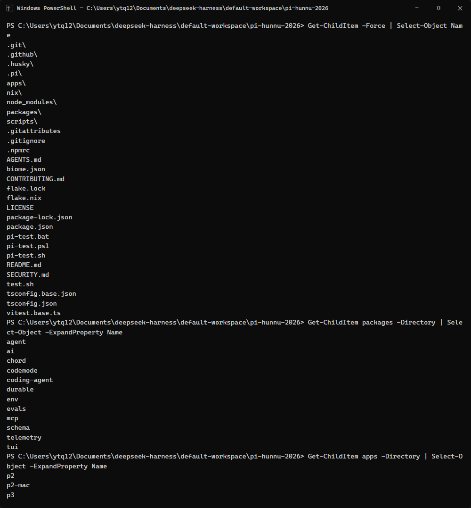
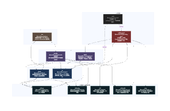
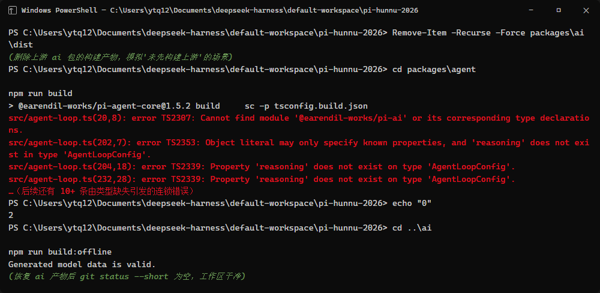

# 实践课2：小组组织建仓与 Pi Agent 源码阅读

| 项目 | 内容 |
| --- | --- |
| 姓名 | 杨唐清 |
| 学号 | 202430224092 |
| 课程 | 匈奴开源软件开发 |
| GitHub 登录名 | sakoto505 |
| 日期 | 2026-11-23 |
| 小组组织 | `nai-lon-g` |
| 小组代码仓库 | https://github.com/nai-lon-g/pi-hunnu-2026 |
| 实际 clone 地址 | https://github.com/nai-lon-g/pi-hunnu-2026.git |
| 分支 / 提交编号 | `main` / `c3cc91632d0a1950fb122605b190233f2aa0006e` |
| 本人重点分析的模块 | **coding-agent（pi）** 与 **agent（pi-agent-core）**，并完整追了 coding-agent → agent → ai → schema 这条依赖链 |

> 按作业要求完成三项任务：组长把课程仓库 fork 到小组组织（任务一）、从小组组织仓库下载源码并确认版本（任务二）、分析 11 个子模块的功能与依赖关系并画图回答三个问题（任务三）。本次 fork 由我在小组组织 `nai-lon-g` 下完成（2026-11-23，小组其他成员可基于该仓库继续共同开发）。

## 1. 任务一：小组组织内的 fork 仓库

小组组织是 `nai-lon-g`（实践课 1 的 Issue 即提交在该组织的 `00-group` 仓库）。实验开始时组织内只有 `00-group`、`git-simple` 两个旧仓库，没有 pi-hunnu-2026 的 fork，因此以 `nai-lon-g` 为 Owner 从教师仓库 `hunnuOpenSourceSoftware2026/pi-hunnu-2026` 创建 fork，仓库名保持 `pi-hunnu-2026`，得到：

**https://github.com/nai-lon-g/pi-hunnu-2026**

页面顶部有 "forked from hunnuOpenSourceSoftware2026/pi-hunnu-2026" 横幅，确认仓库归属小组组织、来源为课程仓库（不是照抄作业示意截图里的教师组织 Owner）：



*图 1 小组组织仓库 nai-lon-g/pi-hunnu-2026 的 GitHub 页面，可见 fork 来源横幅与完整文件结构。*

仓库地址已发到小组；我是组织成员（MEMBER），对仓库有后续开发所需的读写权限（fork 后成员默认继承组织内权限，可推分支、发起 PR）。

## 2. 任务二：下载源码并确认来源版本

在全英路径下从小组组织仓库克隆 main 分支（`--depth 1` 浅克隆，只取最新提交；原因见实践课 3 报告 6.2 节——本机 schannel TLS 大传输不稳定）：

```powershell
git clone --depth 1 --branch main https://github.com/nai-lon-g/pi-hunnu-2026.git
cd pi-hunnu-2026
```

来源与版本确认（`git status --short` 无输出，工作区干净）：

```powershell
Get-Location        # C:\Users\ytq12\Documents\deepseek-harness\default-workspace\pi-hunnu-2026
git remote -v       # origin  https://github.com/nai-lon-g/pi-hunnu-2026.git (fetch/push)
git branch --show-current   # main
git rev-parse HEAD          # c3cc91632d0a1950fb122605b190233f2aa0006e
```



*图 2 本地克隆状态：origin 指向小组组织仓库，main 分支，HEAD `c3cc9163...`（与教师仓库 main 最新提交一致，fork 内容未走样）。*

源码目录（安装构建后的状态，含 `node_modules`）：



*图 3 仓库顶层与 packages/、apps/ 目录列表。*

**与作业清单的差异（以实际代码为准）：** `packages/` 下实际有 **12** 个目录，比作业表格多一个 `evals`——它是评测脚本包，只有 `devDependencies`（pi-ai、pi-coding-agent）、没有 `build` 脚本，**不在**根 `scripts.build` 的 11 步序列里，构建时不参与，所以分析表按作业的 11 个模块写，evals 单列说明。`apps/` 下的 `p2`、`p2-mac`、`p3` 同样是独立应用，不在根构建序列中（p2 按仓库 AGENTS.md 约定有自己的 check/test）。

## 3. 任务三：子模块功能与依赖关系分析

### 3.1 模块分析表

构建顺序（根 `scripts.build` 的实际序列）：`telemetry → schema → chord → tui → codemode → mcp → ai → durable → env → agent → coding-agent`。

| 子文件夹 | 代码主要实现什么功能 | 本模块 build 执行什么、生成什么 | 直接依赖哪些内部模块 | 依据文件或代码位置 |
|---|---|---|---|---|
| `telemetry` | 供应商无关的遥测契约：`TelemetryContext`/`TelemetrySpan` 回调式接口、`NOOP_TELEMETRY_CONTEXT`、跨进程传播与 span link、counter/histogram 等指标 schema、内存参考实现；**不含** exporter 和任何遥测后端依赖 | `tsc -p tsconfig.build.json`，生成 `dist/`（JS + 类型声明） | 无 | `README.md`（"no exporter… no dependency on a telemetry backend"）；`package.json` 无内部依赖 |
| `schema` | JSON Schema（2020-12 与 draft-7）构建器与校验器：schema 编译成纯闭包、不用 `eval`、零依赖；官方测试套件 2222/2223 通过；错误定位到 JSON Pointer 路径；8.5 KB（min+gzip） | `tsc -p tsconfig.build.json`，生成 `dist/` | 无 | `README.md`；`package.json` 无内部依赖 |
| `chord` | 跨进程对象运行时：object 契约（用 pi-schema 描述）、facet 插件与热重载、活引用（reference）、documents/derives/jobs、store 与查询、memory/ipc/webSocket links、每调用一个 principal；规则书为 `docs/design.md` | `tsc -p tsconfig.build.json`，生成 `dist/` | schema、telemetry | `README.md`；`package.json` dependencies；`src/contracts/schema.ts`（`export { Optional, opt, type Schema, type Static } from "@earendil-works/pi-schema"`） |
| `tui` | 终端 UI 框架：差分渲染（只刷变化行）、CSI 2026 同步输出防闪烁、主屏/备用屏两种渲染器、bracketed paste、组件库（Text/Input/Editor/Markdown/SelectList/ScrollView…）、Kitty/iTerm2 行内图片、补全 | `tsc -p tsconfig.build.json`，生成 `dist/`（`main: dist/index.js`） | 无 | `README.md`（Features 列表）；`package.json` 无内部依赖 |
| `codemode` | 沙箱执行模型写的 JavaScript：QuickJS 编译为 WASM，脚本唯一能力是调用注入的工具（`tools`/`ALL_TOOLS`/`text`/`image`/`exit`/`store`/`load`）；嵌套工具调用不进 LLM 上下文；Node/Bun 用 worker 线程沙箱，CF Workers 用 Durable Object 沙箱（`/portable` 子入口） | `tsc -p tsconfig.build.json`，生成 `dist/` | 无（README 明确 "no pi dependencies"） | `README.md`；`package.json` 无内部依赖 |
| `mcp` | 独立的 Model Context Protocol 客户端：transport 中立的 client 核心、stdio 与 Streamable HTTP 两种传输、管道 stdio、内存测试传输；不依赖官方 MCP SDK | `tsc -p tsconfig.build.json`，生成 `dist/` | 无 | `README.md`（"does not depend on the official MCP SDK or other pi packages"）；`package.json` 无内部依赖 |
| `ai` | 统一 LLM API：内置 provider 集合（openai/anthropic/deepseek/groq/…44 个）、模型目录（只收支持 tool calling 的模型）、自动鉴权解析、token 与成本统计、上下文持久化与中途换模型 | 两步：`generate-models`（`node catalog/generate.ts --strict` 联网抓取 models.dev、OpenRouter、Vercel AI Gateway 等目录，生成 `src/models.generated.ts` + `src/providers/data/*.json`——本次实测统计 1696 个 tool-capable 模型）；再 `build:offline`（校验模型数据 + `tsc` 编译 + 把 `src/providers/data` 拷进 `dist/`） | schema、telemetry | `README.md`；`package.json` dependencies 与 scripts；`src/providers/compat-schema.ts`、`src/providers/model-schema.ts`（import pi-schema）、`src/telemetry.ts`（import pi-telemetry）；本次构建日志（实践课 3 报告 S5） |
| `durable` | （实验性）持久化 agent 运行时：对话、模型轮次、工具调用和自定义状态先提交存储再展示；进程中途死亡重开存储可续跑，死在模型请求上则该请求计为失败尝试并重试 | `tsc -p tsconfig.build.json`，生成 `dist/` | chord、ai、codemode、schema、telemetry | `README.md`（"Built on pi-ai for model access and chord for document state"）；`package.json` dependencies；`src/codemode/codemode.ts`（import `chord/context`、`chord/delta`、`pi-codemode/portable`） |
| `env` | Pi Durable 的远程执行环境：远端机器上的小型 Rust daemon（stdin/stdout 帧协议，做文件操作与命令执行）+ 本机 `RemoteExecutionEnv` 客户端（SSH 连接、主机密钥指纹确认）；agent 的工具在另一台机器跑，worker、存储和凭据留在本地 | `tsc -p tsconfig.build.json`，生成 `dist/` | chord、durable | `README.md`（协议/语义见 `docs/protocol.md`、`docs/semantics.md`）；`package.json` dependencies；`src/list-files.ts`、`src/errors.ts`（import `pi-durable/env`）、`src/remote-env.ts`（import `chord/context`） |
| `agent`（pi-agent-core） | 通用有状态 agent：agent 循环（模型流式事件 → 分发工具调用 → 收集结果回填下一轮）、传输抽象、状态管理、附件支持；不含具体 UI 和工具实现 | `tsc -p tsconfig.build.json`，生成 `dist/` | ai、schema | `README.md`（"Stateful agent with tool execution and event streaming. Built on pi-ai"）；`package.json` dependencies；`src/agent-loop.ts` 第 20 行（import pi-ai）、`src/types.ts`（`import type { Static } from "@earendil-works/pi-schema"`） |
| `coding-agent`（pi） | 本次课程的主角产品 "Pi"：coding agent CLI，内置 read/bash/edit/write 工具、交互 TUI、会话管理、扩展/技能/提示模板/主题、MCP 服务器接入、codemode 内置工具、`pi install/update` 子命令等；`bin.pi` → `dist/bundle/cli.js` | 两步：`build:unbundled`（`tsc -p tsconfig.build.json` 编译 → 给 `dist/cli.js`、`dist/rpc-entry.js` 加可执行属性 → 拷贝主题/资源文件）再 `node ../../scripts/build-coding-agent-bundle.mjs`（esbuild 打单文件 bundle）→ 生成 `dist/` + `dist/bundle/`（本次实测 84 files / 9.4 MiB） | agent、ai、codemode、mcp、tui | `README.md`（Pi）；`package.json` 的 bin/scripts/dependencies；`src/core/mcp-servers.ts`（import pi-mcp）、`src/extensions/codemode/tool.ts`（import pi-codemode）、`src/cli/auth-login.ts`（import pi-tui）、`src/core/compaction/branch-summarization.ts`（import pi-agent-core） |

（evals：`packages/evals` 为评测脚本包，`devDependencies` 依赖 ai、coding-agent，无 build 脚本、不在根构建序列，故未列入上表。）

### 3.2 依赖关系图

用 Mermaid 绘制（箭头方向统一为 **使用方 → 被依赖方**；实线 = `dependencies` 直接依赖，虚线 = `devDependencies`；按拓扑深度分 L0–L4 五层）：



*图 4 模块依赖图。可编辑图源：`practice2-diagrams/dependency-graph.mmd`（同仓库，Mermaid 11 渲染）。*

**层级划分依据：** 对内部依赖图做拓扑分层，层号 = 0 + max(直接依赖的层号)（无内部依赖者为 L0 基础层）。

- **L0（无内部依赖）：** telemetry、schema、tui、codemode、mcp —— 五个叶子包互相之间零依赖，可独立构建、独立复用（codemode、mcp 的 README 都明确"无 pi 依赖，可单独使用"）。
- **L1：** ai（→schema, telemetry）、chord（→schema, telemetry）—— 都只依赖基础契约层。
- **L2：** agent（→ai, schema）、durable（→chord, ai, codemode, schema, telemetry）—— 构建块最多的包。
- **L3：** env（→chord, durable）。
- **L4（应用层）：** coding-agent（→agent, ai, codemode, mcp, tui）、evals（dev →ai, coding-agent，虚线）。

依赖边与 3.1 表 package.json 声明一一对应；我还用源码 grep 抽查了各条 import（如 `agent/src/agent-loop.ts:20` import pi-ai、`ai/src/providers/compat-schema.ts` import pi-schema、`durable/src/codemode/codemode.ts` import `chord/context` 与 `pi-codemode/portable`、`env/src/list-files.ts` import `pi-durable/env`），声明与真实引用一致，没有发现"声明了不用"或"用了没声明"的内部依赖。

### 3.3 三个问题的回答

**问题 1：根目录与子模块中的 `npm run build` 分别读取什么配置、执行什么工作？**

- **根目录**读根 `package.json` 的 `scripts.build`。它本身**不做任何编译**，是一条 `&&` 连接的 shell 命令：依次 `cd packages/telemetry`、`cd ../schema` … 直到 `cd ../coding-agent`，对 11 个子包各执行一次 `npm run build`。根配置里真正与"构建"相关的还有 `workspaces`（`packages/*`、`apps/*` 等）——它决定了从根 `npm install` 时所有子包被链接进同一份 `node_modules`，子包之间的内部依赖按本地路径解析，这是"按根脚本顺序构建"能成立的前提。
- **子模块**读**自己目录** `package.json` 的 `scripts.build`：9 个包是 `tsc -p tsconfig.build.json`（TypeScript 按该包自己的 `tsconfig.build.json` 把 `src/` 编译进 `dist/`）；ai 包是 `generate-models && build:offline`（先联网生成模型目录，再校验 + 编译 + 拷数据）；coding-agent 是 `build:unbundled && esbuild 打包`。所以 npm 只是脚本执行器，"build 干什么"完全由项目配置决定。

**问题 2：构建顺序和模块依赖有什么关系？相邻构建的模块是否一定互相依赖？**

- **关系：构建顺序就是内部依赖 DAG 的一个拓扑序**——每个包都排在它直接依赖的内部包之后。逐一核对 11 步序列：chord 依赖 telemetry(1)、schema(2) ✓；ai 依赖 telemetry(1)、schema(2) ✓；durable 依赖 chord(3)、ai(7)、codemode(5)、schema(2)、telemetry(1) ✓；env 依赖 chord(3)、durable(8) ✓；agent 依赖 ai(7)、schema(2) ✓；coding-agent 依赖 agent(10)、ai(7)、codemode(5)、mcp(6)、tui(4) ✓。所有依赖都先构建。
- **相邻不一定互相依赖。** 反例：序列中 env（第 9）与 agent（第 10）相邻，但 agent 只依赖 ai 和 schema，与 env 没有任何依赖关系——拓扑序只要求"依赖在前"，不依赖的包之间的相对位置是任意的，env 和 agent 恰好被排在一起。
- **为什么顺序是硬约束（实验）：** 子包的 `tsc` 编译时要通过 `node_modules` 里指向本地包的链接读上游包 `dist/` 中的类型（`main`/`types` 指向 `dist/index.js`、`dist/index.d.ts`）。我把 `packages/ai/dist` 删掉后直接在 `packages/agent` 构建，`tsc` 立刻报 `error TS2307: Cannot find module '@earendil-works/pi-ai'`（`src/agent-loop.ts` 第 20 行），退出码 2，并连锁出一串类型错误；重建 ai 后 agent 可正常构建：



*图 5 "未构建上游"实验：agent 构建失败于 TS2307；恢复 ai 产物后 `git status` 干净。*

**问题 3：一条涉及至少三个模块的依赖路径及其分工**

选 **coding-agent → agent（pi-agent-core）→ ai（pi-ai）→ schema（pi-schema）**（4 个模块）：

- **coding-agent（应用形态层）：** 负责"pi 长什么样"——交互 TUI（依赖 pi-tui）、会话文件管理、内置 read/bash/edit/write 工具、扩展/技能/主题、MCP 接入（pi-mcp）、沙箱代码执行（pi-codemode）。它**不自己实现** agent 循环，也不自己调模型，而是把 agent-core 组装进终端产品。
- **agent（循环与状态层）：** 负责"怎么和模型对话"——agent 循环：把模型流式事件解析出来、分发工具调用、把工具结果回填进上下文发起下一轮；外加传输抽象、状态管理、附件。它知道"要调模型"，但不知道模型是什么协议——具体调用委托给 ai。
- **ai（模型与 provider 层）：** 负责"调哪个模型、怎么调"——provider 集合与模型目录（能力、上下文窗口、价格）、鉴权解析（API key/OAuth）、把统一的对话请求转成具体 provider 的 HTTP 请求并流式解析响应、token 与成本统计、上下文持久化/换模型。
- **schema（契约层）：** 负责"数据长什么样"——JSON Schema 构建与校验（无 eval、零依赖）。ai 用它定义和校验模型输入/输出与工具参数结构（`src/providers/compat-schema.ts`、`model-schema.ts`）；agent 用它拿类型收窄（`src/types.ts` 的 `Static`）；连 ai 的 provider 能力字段也是 schema 描述。它是这条链最底下的公共契约。
- **一句话分工：** coding-agent 管产品形态与工具，agent 管循环与状态，ai 管模型调用与 provider，schema 管数据契约与校验——每层只依赖下层的抽象接口，因此换 provider、换 UI（TUI/RPC）都不用动中间层。

## 4. 截图与文件清单

| 文件 | 内容 |
| --- | --- |
| `practice2-images/01-org-repo.png` | 小组组织 fork 仓库 GitHub 页面（fork 来源横幅） |
| `practice2-images/02-clone-state.png` | clone 后目录/远端/分支/提交编号 |
| `practice2-images/03-source-tree.png` | 源码目录结构（顶层 + packages/ + apps/） |
| `practice2-images/04-dependency-graph.png` | 模块层级与依赖关系图（L0–L4，使用方→被依赖方） |
| `practice2-images/05-ts2307-experiment.png` | "未构建上游"TS2307 实验现场 |
| `practice2-diagrams/dependency-graph.mmd` | 依赖图 Mermaid 可编辑图源 |

## 5. 提交方式

- 本报告与图片在个人作业仓库：https://github.com/sakoto505/pi-agent-homework
- 小组代码仓库（后续共同开发用）：https://github.com/nai-lon-g/pi-hunnu-2026
- 实际 clone 地址：https://github.com/nai-lon-g/pi-hunnu-2026.git
- 课程作业仓库 Issue 与小组 00-group Issue 标题：`实践课2：组织建仓与源码分析 yangtangqing`
