# 实践课3：Pi Agent 源码获取、依赖安装与本地编译

| 项目 | 内容 |
| --- | --- |
| 姓名 | 杨唐清 |
| 学号 | 202430224092 |
| 课程 | 匈奴开源软件开发 |
| GitHub 登录名 | sakoto505 |
| 日期 | 2026-11-23 |
| 源码位置 | `C:\Users\ytq12\Documents\deepseek-harness\default-workspace\pi-hunnu-2026`（全英路径） |
| 小组组织仓库 | https://github.com/nai-lon-g/pi-hunnu-2026 |
| 实际 clone 地址 | https://github.com/nai-lon-g/pi-hunnu-2026.git |
| 源码分支 / 提交编号 | `main` / `c3cc91632d0a1950fb122605b190233f2aa0006e` |

> 第一次实践课侧重安装和使用 Pi 客户端，本次侧重建立本地源码开发环境。本次完成了作业的六项任务：检查开发工具（S1）、获取小组组织内 fork 的源码（S2）、阅读安装与编译的配置依据（S3）、安装依赖（S4）、本地编译并验证产物（S5）、用源码入口启动并完成一次会话（S6），并重点记录了遇到的困难与解决过程（第 6 节，4 张现场截图）。本次未构建独立 EXE，也未部署大模型权重。

## 1. 实验准备：检查和安装开发工具（S1）

按作业要求，打开 PowerShell 逐条执行三条检查命令：

```powershell
node --version
npm --version
git --version
```

本机实际结果：**Node.js v24.21.0、npm 11.19.0、Git 2.55.0.windows.5**，并额外执行了 `node -e "console.log('Hello, Node.js!')"` 验证运行时可用。

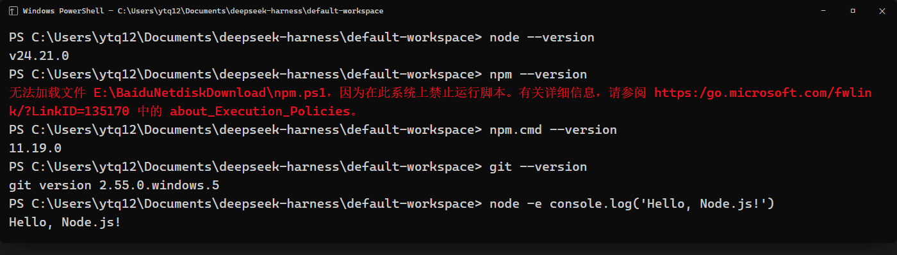

*图 S1 环境检查输出。其中 `npm --version` 一行报红错，这是真实遇到的第一个困难，详见第 6.1 节；改用 `npm.cmd` 后得到版本 11.19.0。*

**我的理解：** 根 `package.json` 的 `engines` 声明 `"node": ">=22.19.0"`。本机是 Node.js 24（作业建议的统一版本），既满足根项目声明，也不会像作业文档图 2 那样因为某个依赖（如 `@earendil-works/gondolin@0.12.0` 要求 `>=23.6.0`）触发 `EBADENGINE` 警告——实际上我这次安装日志里也没有出现 EBADENGINE。npm 随 Node.js 官方安装程序一起提供，没有单独安装。Node 安装在 `E:\BaiduNetdiskDownload`（通过百度网盘离线包安装的版本），`Get-Command node` 可以确认。

## 2. 下载课程仓库源码（S2）

小组组织是 `nai-lon-g`。实验开始时该组织里还没有 pi-hunnu-2026 的 fork（组织内只有 00-group 和 git-simple 两个旧实验仓库），所以先在教师仓库 `hunnuOpenSourceSoftware2026/pi-hunnu-2026` 上以 `nai-lon-g` 组织创建 fork，得到 **https://github.com/nai-lon-g/pi-hunnu-2026**，然后在全英路径下克隆：

小组 fork 仓库的 GitHub 页面（可见 "forked from hunnuOpenSourceSoftware2026/pi-hunnu-2026" 横幅，证明源码来源是小组组织内的仓库）：

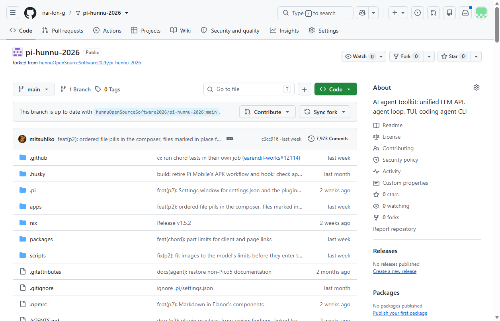

*图 S2a 小组组织仓库 `nai-lon-g/pi-hunnu-2026` 的 GitHub 页面：显示其 fork 自教师仓库，文件结构与课程仓库一致。*

```powershell
git clone --depth 1 --branch main https://github.com/nai-lon-g/pi-hunnu-2026.git
cd pi-hunnu-2026
```

克隆时用了 `--depth 1` 浅克隆（只取 main 最新提交），原因见第 6.2 节。随后执行作业要求的来源确认命令：

```powershell
Get-Location
git remote -v
git branch --show-current
git rev-parse HEAD
git status --short
```

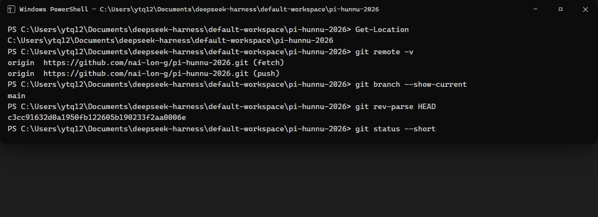

*图 S2 `origin` 指向小组组织仓库 nai-lon-g/pi-hunnu-2026，分支 main，HEAD 为 `c3cc91632d0a1950fb122605b190233f2aa0006e`，工作区干净。*

**我的理解：** 提交编号 `c3cc916...` 与同学们实践课 2 记录的源码提交一致，说明 fork 内容就是课程仓库 main 的最新状态。浅克隆只拿到最新一次提交，`git rev-parse HEAD` 输出的仍是完整提交编号，不影响记录；后续所有安装和构建命令都在这个仓库根目录执行。

## 3. 阅读配置，确认安装与编译的依据（S3）

用 VS Code 打开仓库，重点观察了根 `package.json` 和 `packages/coding-agent/package.json`：

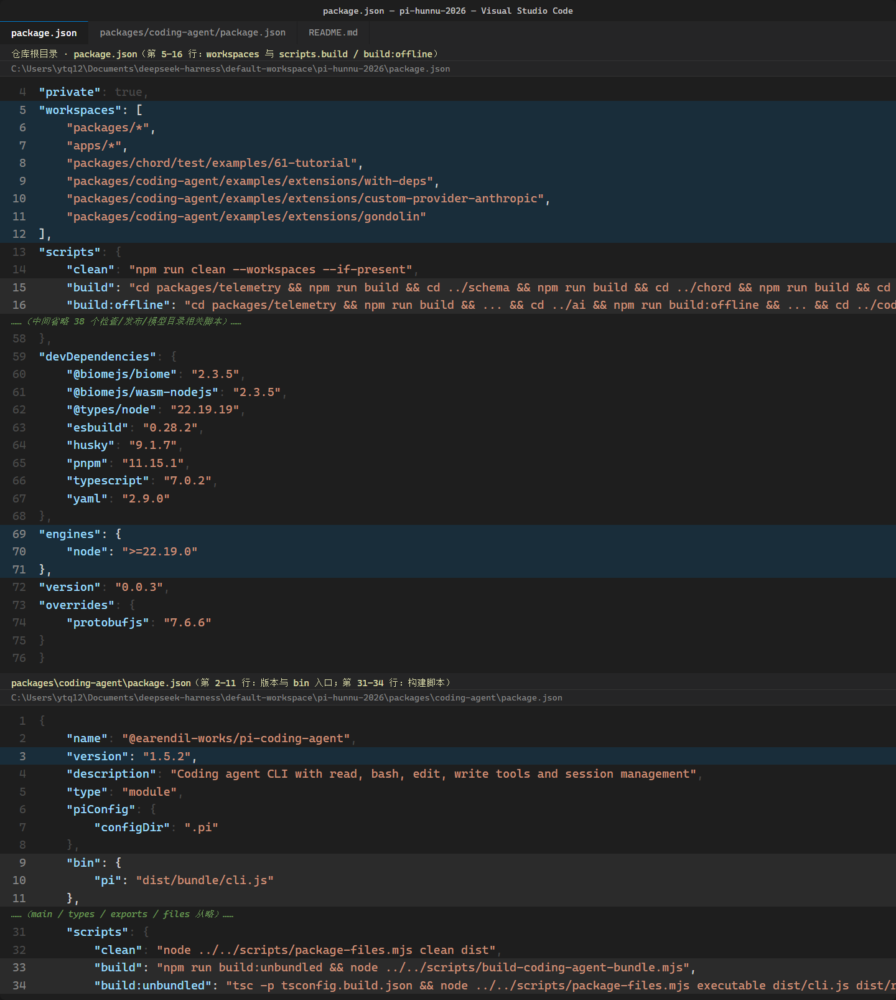

*图 S3 上：根 package.json 的 `workspaces`（第 5–12 行）、`scripts.build` / `build:offline`（第 15–16 行）、`engines.node`（第 69–71 行）；下：coding-agent 包的 `version: 1.5.2`、`bin.pi: dist/bundle/cli.js`、`build` 脚本。*

**作业要求回答的两个问题：**

1. **Node.js 版本要求在哪里？** 在根目录 `package.json` 的 `engines` 字段：`"node": ">=22.19.0"`。它约束的是运行本仓库脚本所需的 Node.js 最低版本，npm 在 install 时会对照当前版本，不满足时给出 EBADENGINE 警告（不直接失败）。
2. **`npm run build` 实际从哪里读取命令？** 从**执行命令时所在目录**的 `package.json` 的 `scripts` 字段读取。在仓库根目录执行 `npm run build`，读的就是根 `package.json` 的 `scripts.build`，它是一条由 `&&` 连接的长命令，依次 `cd` 进 11 个子包（telemetry → schema → chord → tui → codemode → mcp → ai → durable → env → agent → coding-agent）并对每个子包执行各自的 `npm run build`。每个子包的 `build` 脚本又是从它自己目录下的 `package.json` 读取的——所以"npm 对所有项目执行同一套编译"是不对的，npm 只是脚本执行器，具体干什么完全由项目配置决定。

**我的理解：** 该仓库是 npm workspaces monorepo（`workspaces` 声明了 `packages/*`、`apps/*` 和 3 个示例扩展目录），所以依赖必须**从根目录一次性安装**（根下只有一份 `node_modules` 和一份 `package-lock.json`），构建要**按根脚本声明的顺序**执行（子包之间有依赖，比如 coding-agent 依赖 agent、agent 依赖 ai 等，先构建上游才不会报 TS2307），不能给每个子包分别再装依赖、再建 lock 文件。`scripts.build` 与 `scripts.build:offline` 的区别只在 ai 包：在线版跑 `generate-models`（联网拉模型目录），离线版跑 `build:offline`（复用已生成的模型数据）。

## 4. 安装项目依赖（S4）

确认当前目录包含根 `package.json` 后执行：

```powershell
npm install --ignore-scripts
```

实际输出（结尾）：

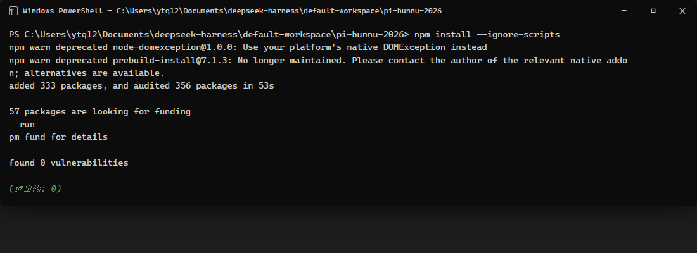

*图 S4 安装结束输出：2 条 `npm warn deprecated` 警告、`added 333 packages, and audited 356 packages in 53s`、`found 0 vulnerabilities`，退出码 0。*

**命令作用说明：**

- 根据根 `package.json` + `package-lock.json` 解析并下载依赖；lock 文件与声明一致时按锁定版本安装。
- 在仓库根建立本地 `node_modules`，并按 workspaces 把 `packages/*`、`apps/*` 等本地包以软链接方式关联进去。
- `--ignore-scripts` 跳过安装阶段自动触发的生命周期脚本（本仓库如根 `prepare: husky`），避免安装依赖时执行未知脚本；它不影响之后手动执行的 `npm run build`。
- 没有 `-g`，装的是当前项目的依赖，不会把本地改过的 Pi 变成全局 `pi` 命令。

**警告与错误的区分（作业要求）：** 本次输出里的 `npm warn deprecated node-domexception@1.0.0` 和 `npm warn deprecated prebuild-install@7.1.3` 是**弃用提示**（两个都是传递依赖），不是错误，命令仍成功结束（退出码 0）；`found 0 vulnerabilities` 表示本次审计没有已知漏洞，但它只是审计结果，不等于构建成功。作业也提醒**不要**直接 `npm audit fix --force`——可能改动课程使用的锁定版本。

## 5. 本地编译与构建产物验证（S5）

仍在仓库根目录执行：

```powershell
npm run build
```

完整日志 127 行，关键部分（ai 包联网生成模型目录 + 结尾打包）：

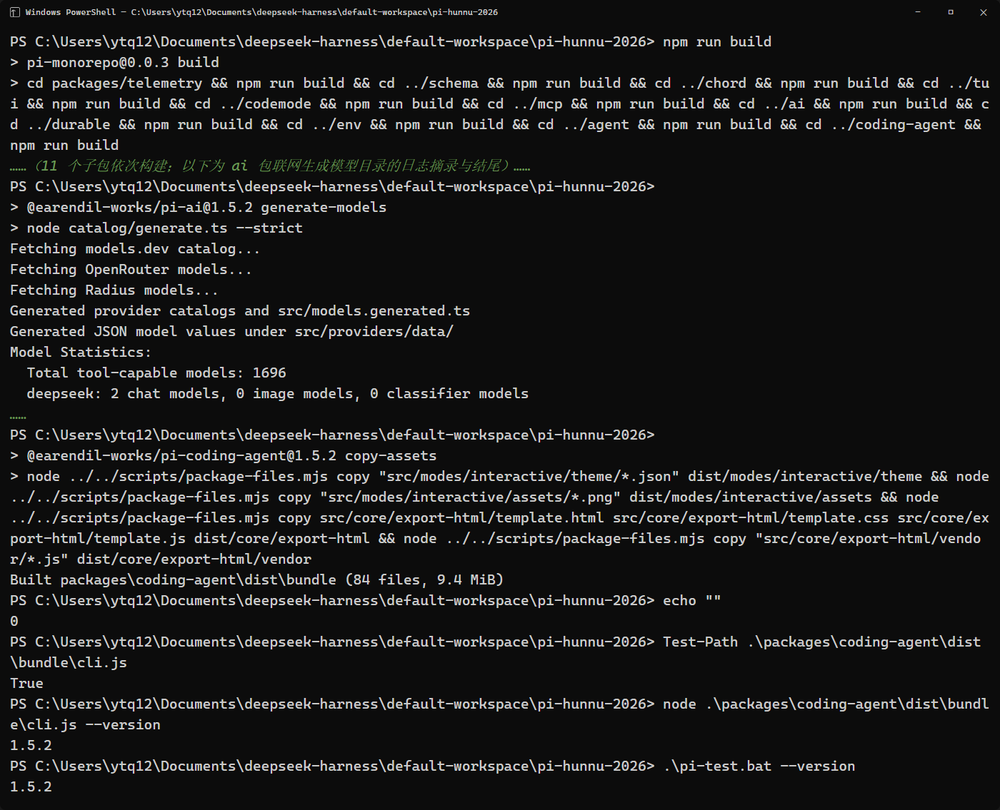

*图 S5 构建日志摘录（ai 包 `generate-models` 联网抓取 models.dev / OpenRouter 等目录，生成 `models.generated.ts` 与 provider JSON，统计 1696 个 tool-capable 模型）与结尾（coding-agent 打包 `dist/bundle`，84 files、9.4 MiB），退出码 0，以及产物验证：`Test-Path` 为 True、`node .\packages\coding-agent\dist\bundle\cli.js --version` 输出 1.5.2、`.\pi-test.bat --version` 输出 1.5.2。*

**构建实际执行了什么（我的理解）：**

1. 根 `scripts.build` 依次进入 11 个子包执行各自的 `build`。大部分子包（telemetry/schema/chord/tui/codemode/mcp/durable/env/agent）的 build 就是 `tsc -p tsconfig.build.json`（TypeScript 编译出 `dist/`）。
2. **ai 包**特殊：先 `npm run generate-models`（`node catalog/generate.ts --strict`）联网拉取各供应商的**模型目录**（名称、能力、价格、上下文等配置数据），生成 `src/models.generated.ts` 和 `src/providers/data/` 下的 JSON——**这不是下载大模型权重**，本地客户端构建与模型推理服务是两回事；再 `build:offline`（校验模型数据 + tsc 编译 + 拷贝数据进 dist）。
3. **coding-agent 包**：`build:unbundled`（tsc 编译 + 给 `dist/cli.js`、`dist/rpc-entry.js` 加可执行属性 + 拷贝主题/资源文件）之后用 `build-coding-agent-bundle.mjs`（esbuild）打出单文件 bundle `dist/bundle/cli.js`，即 `bin.pi` 指向的入口。
4. 产物验证：`Test-Path .\packages\coding-agent\dist\bundle\cli.js` 输出 `True`；用 node 直接跑该入口 `--version` 输出 **1.5.2**（与 coding-agent 包 `package.json` 的 version 一致），证明跑的就是本次源码构建的版本，而不是全局安装的 pi（实践课 1 装的是 1.5.0）。
5. 以后重新构建用 `npm run build:offline`（复用模型目录数据、仍重新编译）；只有修改了源码才需要重新构建，直接改 `dist/` 下的文件会在下次构建时被覆盖，改程序要改 `src/`。

## 6. 遇到的困难与解决过程（重点）

### 6.1 `npm` 在 PowerShell 里直接报"禁止运行脚本"

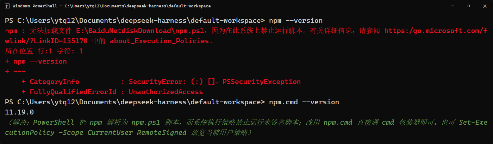

**现象：** 第一条 `npm --version` 就报红错：无法加载 `E:\BaiduNetdiskDownload\npm.ps1`，因为在此系统上禁止运行脚本（PSSecurityException）。

**原因：** Node 安装目录里同时有 `npm.cmd` 和 `npm.ps1` 两个包装器。PowerShell 查找命令时优先把 `npm` 解析成 `npm.ps1` 这个脚本，而本机所有作用域的执行策略都是 Undefined（等效 Restricted），未签名脚本被禁止。

**解决：** 本次实验统一改用 `npm.cmd`（直接调 cmd 包装器，不经过 .ps1 脚本），后续安装、构建全部成功。另一个通用办法是 `Set-ExecutionPolicy -Scope CurrentUser RemoteSigned` 放宽当前用户策略（本次没有动系统策略）。

### 6.2 `git clone` 用默认 schannel 通道两次中途断开

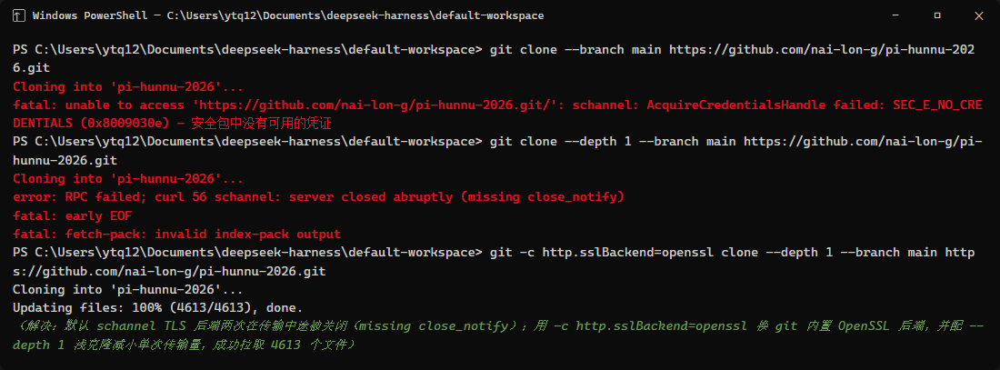

**现象：** 完整克隆报 `schannel: AcquireCredentialsHandle failed: SEC_E_NO_CREDENTIALS (0x8009030e)`；改浅克隆后仍报 `error: RPC failed; curl 56 schannel: server closed abruptly (missing close_notify)` → `fatal: early EOF`。

**原因：** Git for Windows 默认用 schannel 做 TLS，这台机器到 GitHub 的传输在 schannel 下两次都在中途被关闭（curl 20 能连通 GitHub，排除完全断网）。

**解决：** 用 git 内置的另一个 TLS 后端重试：`git -c http.sslBackend=openssl clone --depth 1 --branch main https://github.com/nai-lon-g/pi-hunnu-2026.git`，`--depth 1` 同时把单次传输量从约 110MB 历史降到只取最新提交，最终成功检出 4613 个文件。

### 6.3 系统里存的 GitHub 凭证已过期（API 401）

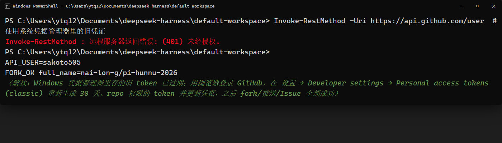

**现象：** 用 Windows 凭据管理器里存的旧凭证调 `api.github.com` 返回 401 未经授权，无法 fork 小组仓库、无法 push 报告。

**原因：** 旧凭证是一个 49 位的 fine-grained token，已到期失效。

**解决：** 用浏览器登录 GitHub（会话有效，仅需 sudo 密码确认），在 设置 → Developer settings → Personal access tokens (classic) 重新生成一个 30 天有效、勾选 `repo` 权限的 token（备注 dsh-practice3-build），更新系统凭据后 `api.github.com` 返回正常（`sakoto505`），随即完成：在 nai-lon-g 组织 fork 教师仓库 → 克隆 → 推送本报告 → 提交 Issue。该 token 仅 `repo` 权限、30 天过期，到期后在 GitHub 设置里可随时删除。

### 6.4 模型调用 402：DeepSeek 余额不足

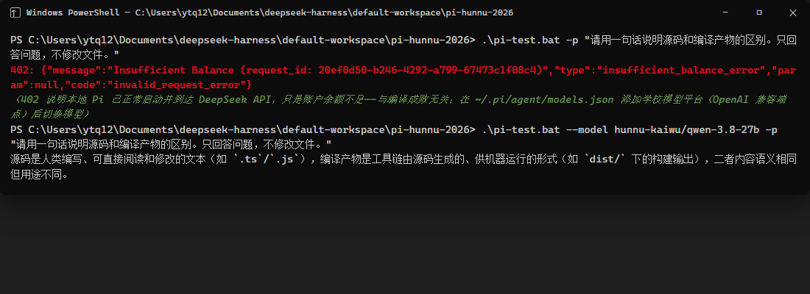

**现象：** `.\pi-test.bat -p "请用一句话说明…"` 本地程序正常启动，但模型调用返回 `402: Insufficient Balance`。

**原因与定性：** 402 是 DeepSeek API 侧返回的"账户余额不足"。**本地程序启动成功**和**模型调用失败**是两件事，不能混为编译失败——Pi 已经正常读源码、起会话、把请求发到了模型服务，只是该账户没钱了。

**解决：** 没有充值，改用学校模型平台。先查 `~/.pi/agent` 下已配置的 provider（只有 deepseek），然后在 `~/.pi/agent/models.json` 里按 pi 文档"Configure a compatible endpoint"添加自定义 provider `hunnu-kaiwu`（`baseUrl: https://models.hunnu.edu.cn/v1`，`api: openai-completions`，key 用环境变量插值 `$HUNNU_KAIWU_API_KEY`，注册 `qwen-3.8-27b`、`deepseek-v4-flash` 两个模型），再 `.\pi-test.bat --model hunnu-kaiwu/qwen-3.8-27b -p "…"` 重跑，收到真实模型回复（见 S6）。

## 7. 启动本地源码版本并完成一次会话（S6）

源码入口是仓库根的 `pi-test.bat`（名字带 test，但它是**运行本地源码的入口**，不是测试套件）：`pi-test.bat` 调 `powershell.exe -NoProfile -ExecutionPolicy Bypass -File pi-test.ps1` 并把参数透传；`pi-test.ps1` 最终执行 `node --import <source-resolver 的 file URL> packages/coding-agent/src/cli.ts <参数>`，即由 Node.js 的 TypeScript 解析器直接加载**源码** `src/cli.ts`。

```powershell
.\pi-test.bat --version
.\pi-test.bat --model hunnu-kaiwu/qwen-3.8-27b -p "请用一句话说明源码和编译产物的区别。只回答问题，不修改文件。"
```

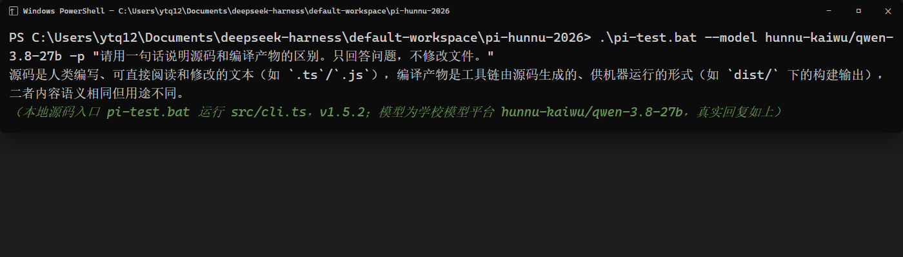

*图 S6 `pi-test.bat --version` 输出 1.5.2（本地源码版本），以及用学校模型平台 `hunnu-kaiwu/qwen-3.8-27b` 完成的一次真实问答。*

**模型实际回复：**

> 源码是人类编写、可直接阅读和修改的文本（如 `.ts`/`.js`），编译产物是工具链由源码生成的、供机器运行的形式（如 `dist/` 下的构建输出），二者内容语义相同但用途不同。

**作业要求回答的两个问题：**

1. **本次如何确保运行的是本地源码？** 三点证据：(a) 入口是 `pi-test.bat → pi-test.ps1 → node --import … src/cli.ts`，加载的是 `packages/coding-agent/src/` 下的源码文件，而不是任何已安装产物；(b) 版本号可区分——本地源码入口和 `dist/bundle/cli.js` 都输出 **1.5.2**（当前源码的版本），而实践课 1 全局安装的是 **1.5.0**，如果误跑了全局 `pi` 会显示 1.5.0；(c) 全程在仓库目录执行，直接输入 `pi` 则可能启动全局版本，所以作业也要求不用 `pi` 而用 `.\pi-test.bat`。
2. **源码入口与 `dist/bundle/cli.js` 入口分别适合什么场景？** `pi-test.bat`（跑 `src/cli.ts`）适合开发/验证：改了源码立刻能跑，用来证明"运行的是当前源码"；`node .\<dist>\bundle\cli.js` 跑的是 esbuild 打包后的产物，适合验证构建结果、模拟用户实际拿到的 `pi` 命令（`bin.pi` 指向它）、排查"源码能跑但打包产物不行"这类问题。两者版本一致（本次都是 1.5.2）说明构建没有丢代码、入口正确。

**配置复用说明：** 本地源码版与全局 Pi 共用 `~/.pi/agent` 配置目录，所以会话能直接用已配置的凭据（本次 DeepSeek 凭据因 402 余额不足不可用，改用了学校模型平台，见 6.4 节）。截图中不含 API Key、auth.json 内容或授权回调地址。

## 8. 总结：源码在哪里、依赖装在哪里、构建执行了什么、正在运行哪个版本

- **源码在哪里：** `C:\Users\ytq12\Documents\deepseek-harness\default-workspace\pi-hunnu-2026`，来自小组组织仓库 `nai-lon-g/pi-hunnu-2026` 的 `main` 分支浅克隆，HEAD `c3cc91632d0a1950fb122605b190233f2aa0006e`。
- **依赖装在哪里：** 只在仓库根的 `node_modules`（npm workspaces，333 packages 直接依赖 + 传递依赖共 audited 356），子包不各自建 `node_modules`/lock 文件；本次没有全局安装任何包（`npm install` 无 `-g`，`--ignore-scripts` 跳过了生命周期脚本）。
- **构建执行了什么：** 根 `npm run build` 按 `scripts.build` 顺序构建 11 个子包——9 个包 `tsc` 编译，ai 包联网生成模型目录（models.generated.ts + provider JSON，共 1696 个 tool-capable 模型，不含权重）后 tsc 编译，coding-agent 包 tsc 编译 + esbuild 打成 `dist/bundle`（84 files / 9.4 MiB）。退出码 0。
- **正在运行哪个版本：** `.\pi-test.bat`（源码入口）和 `node .\packages\coding-agent\dist\bundle\cli.js`（产物入口）都报告 **1.5.2**，与源码 `packages/coding-agent/package.json` 的 version 一致；全局 pi 是 1.5.0。本次会话运行的是 1.5.2 源码入口 + 学校模型平台 qwen-3.8-27b。

## 作业目录

```text
.
├── 实践课3-Pi Agent源码安装与编译-杨唐清.md    # 本报告
└── practice3-images/                          # 本次截图
    ├── S1-env-versions.png
    ├── S2-repo-clone-state.png
    ├── practice2-fork-page.png
    ├── S3-config-package-json.png
    ├── S4-npm-install.png
    ├── S5-build-and-verify.png
    ├── S6-session-source-entry.png
    ├── D1-npm-execution-policy.png
    ├── D2-git-clone-tls.png
    ├── D3-github-token-expired.png
    └── D4-model-402-switch.png
```

| 截图 | 内容 | 文件 |
| --- | --- | --- |
| S1 | 环境版本（含 npm 执行策略报错现场） | `practice3-images/S1-env-versions.png` |
| S2 | 目录 / 远端 / 分支 / 提交编号 | `practice3-images/S2-repo-clone-state.png` |
| S2a | 小组组织 fork 仓库 GitHub 页面（fork 横幅） | `practice3-images/practice2-fork-page.png` |
| S3 | 根与子包 package.json 关键配置 | `practice3-images/S3-config-package-json.png` |
| S4 | npm install 结束输出（警告 vs 0 漏洞） | `practice3-images/S4-npm-install.png` |
| S5 | build 日志摘录 + 退出码 0 + 产物验证 + 双入口版本号 | `practice3-images/S5-build-and-verify.png` |
| S6 | 源码入口会话 + 模型真实回复 | `practice3-images/S6-session-source-entry.png` |
| D1 | npm.ps1 执行策略拦截与解决 | `practice3-images/D1-npm-execution-policy.png` |
| D2 | git schannel 两次断开、openssl 后端成功 | `practice3-images/D2-git-clone-tls.png` |
| D3 | 旧 token 401 过期、重新生成与 fork 成功 | `practice3-images/D3-github-token-expired.png` |
| D4 | DeepSeek 402 与切换学校模型平台成功 | `practice3-images/D4-model-402-switch.png` |

## 提交方式

- 实验报告与截图已上传个人仓库：https://github.com/sakoto505/pi-agent-homework
- 作业链接（本报告）：https://github.com/sakoto505/pi-agent-homework/blob/main/实践课3-Pi%20Agent源码安装与编译-杨唐清.md
- 小组组织仓库：https://github.com/nai-lon-g/pi-hunnu-2026
